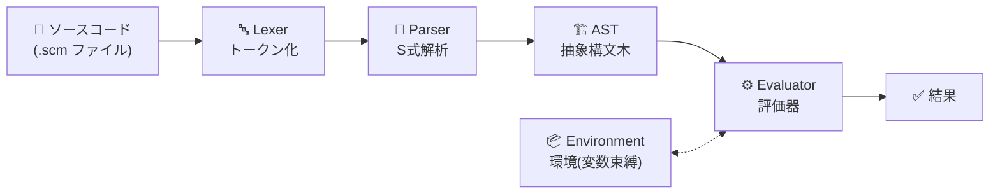
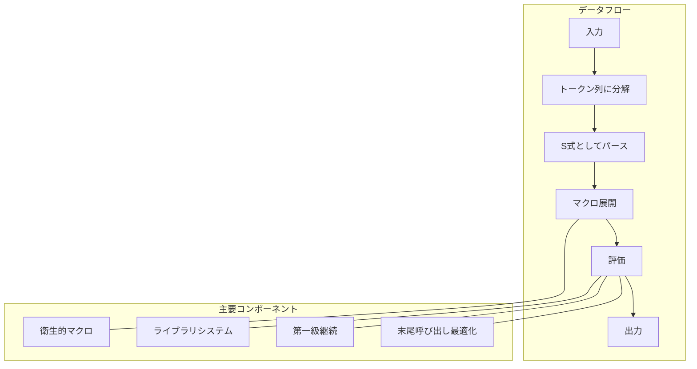

# Sucheme

[](https://github.com/suchi/sucheme-go/actions/workflows/ci.yml)
[](https://codecov.io/gh/suchi/sucheme-go)
[]()

## 概要

**Sucheme** は、Go で実装された R7RS 準拠の Scheme インタプリタです。
名前はリポジトリオーナー **suchi** に由来しています（"scheme" のタイポではありません）。

教育・学習目的から実用まで、Scheme の仕様に忠実な実装を目指しています。
ネイティブバイナリとしても、WebAssembly を通じてブラウザ上でも動作します。

## 特徴

- **R7RS 準拠** — R7RS (small) 仕様に基づいた Scheme インタプリタ
- **衛生的マクロ** — `syntax-rules` による完全なマクロシステム
- **末尾呼び出し最適化 (TCO)** — 適切な末尾再帰の最適化
- **第一級継続** — `call/cc` による継続のサポート
- **WebAssembly 対応** — ブラウザ上で動作する Web REPL
- **クロスプラットフォーム** — Linux, macOS, Windows, WebAssembly をサポート

## アーキテクチャ





## クイックスタート

### インストール

**go install を使う場合:**

```bash
go install github.com/suchi/sucheme-go/cmd/sucheme@latest
```

**バイナリを直接ダウンロード:**

[GitHub Releases](https://github.com/suchi/sucheme-go/releases) から対象プラットフォームのバイナリをダウンロードしてください。

**Web UI で試す:**

インストール不要で、ブラウザから直接お試しいただけます。
https://suchi.github.io/sucheme-go/

### REPL 起動

```bash
sucheme
```

```
sucheme> (+ 1 2)
3
sucheme> (define (fact n) (if (<= n 1) 1 (* n (fact (- n 1)))))
sucheme> (fact 10)
3628800
```

### ファイル実行

```bash
sucheme run examples/hello.scm
```

### CLI オプション

```
sucheme              # REPL モードで起動
sucheme run FILE     # Scheme ファイルを実行
sucheme --help       # ヘルプを表示
sucheme --version    # バージョンを表示
```

## Web UI

ブラウザ上で Sucheme を試せる Web REPL を GitHub Pages で公開しています。

**https://suchi.github.io/sucheme-go/**

Go の WebAssembly ビルドを使用しており、インストール不要で利用できます。

## ビルド方法

### ネイティブビルド

```bash
go build -o sucheme ./cmd/sucheme
```

### WebAssembly ビルド

```bash
GOOS=js GOARCH=wasm go build -o web-ui/sucheme.wasm ./cmd/wasm
```

### テスト実行

```bash
go test ./...
```

### ベンチマーク

```bash
go test -bench=. ./...
```

### カバレッジ

```bash
go test -coverprofile=coverage.out ./...
go tool cover -html=coverage.out -o coverage.html
```

## プロジェクト構造

```
sucheme-go/
├── cmd/
│   ├── sucheme/       # CLI エントリポイント
│   └── wasm/          # WebAssembly エントリポイント
├── pkg/               # ライブラリコード
│   ├── lexer/         # トークナイザ
│   ├── parser/        # S式パーサ
│   ├── evaluator/     # 評価器
│   ├── object/        # Scheme オブジェクト定義
│   └── environment/   # 環境(変数束縛)
├── web-ui/            # Web REPL UI
├── examples/          # サンプル Scheme プログラム
├── docs/              # ドキュメント
│   └── adr/           # Architecture Decision Records
├── go.mod
└── README.md
```

## R7RS 対応状況

> **注意**: 「対応完了」は関連テストが境界例・特殊例を含めてすべてパスした場合のみ付与されます。

| カテゴリ | 項目 | 状況 |
|---------|------|------|
| 基本構文 | `define`, `lambda`, `if`, `cond`, `let` 等 | 未対応 |
| クォート | `quote`, `quasiquote`, `unquote` | 未対応 |
| マクロ | `syntax-rules`, `define-syntax` | 未対応 |
| 末尾呼び出し | 適切な末尾呼び出し最適化 | 未対応 |
| 継続 | `call/cc`, `dynamic-wind` | 未対応 |
| 例外処理 | `guard`, `raise`, `with-exception-handler` | 未対応 |
| 多値 | `values`, `call-with-values` | 未対応 |
| ポート/IO | `open-input-file`, `read`, `write` 等 | 未対応 |
| ライブラリ | `define-library`, `import`, `export` | 未対応 |
| データ型 | boolean, char, string, vector, bytevector | 部分対応 |
| レキサー | トークン化 | 対応完了 |
| パーサー | S式解析 | 対応完了 |

詳細な対応状況は [`docs/`](docs/) ディレクトリを参照してください。

## サンプルコード

### Hello World

```scheme
(display "Hello, World!")
(newline)
```

### フィボナッチ数列

```scheme
(define (fib n)
  (if (<= n 1)
      n
      (+ (fib (- n 1))
         (fib (- n 2)))))

(display (fib 10))  ; => 55
(newline)
```

### 末尾再帰による階乗

```scheme
(define (factorial n)
  (define (loop n acc)
    (if (<= n 1)
        acc
        (loop (- n 1) (* acc n))))
  (loop n 1))

(display (factorial 20))
(newline)
```

### リスト操作

```scheme
(define (my-map f lst)
  (if (null? lst)
      '()
      (cons (f (car lst))
            (my-map f (cdr lst)))))

(display (my-map (lambda (x) (* x x)) '(1 2 3 4 5)))
; => (1 4 9 16 25)
(newline)
```

### マクロの例

```scheme
(define-syntax my-when
  (syntax-rules ()
    ((my-when test body ...)
     (if test (begin body ...)))))

(my-when #t
  (display "条件が真です")
  (newline))
```

## ドキュメント

- [Architecture Decision Records](docs/adr/) — 設計上の決定とその理由
- [`examples/`](examples/) — サンプル Scheme プログラム集

## コントリビューション

コントリビューションを歓迎します。

1. このリポジトリをフォーク
2. フィーチャーブランチを作成 (`git checkout -b feature/my-feature`)
3. 変更をコミット (`git commit -m 'Add my feature'`)
4. ブランチにプッシュ (`git push origin feature/my-feature`)
5. Pull Request を作成

### 開発時の注意

- テスト駆動開発 (TDD) を推奨します
- コミット前に `go test ./...` を実行してください
- コードは `gofmt` でフォーマットしてください
- コミットメッセージは英語の命令形で記述してください

## ライセンス

NOLICENSE — このプロジェクトにはライセンスが設定されていません。
