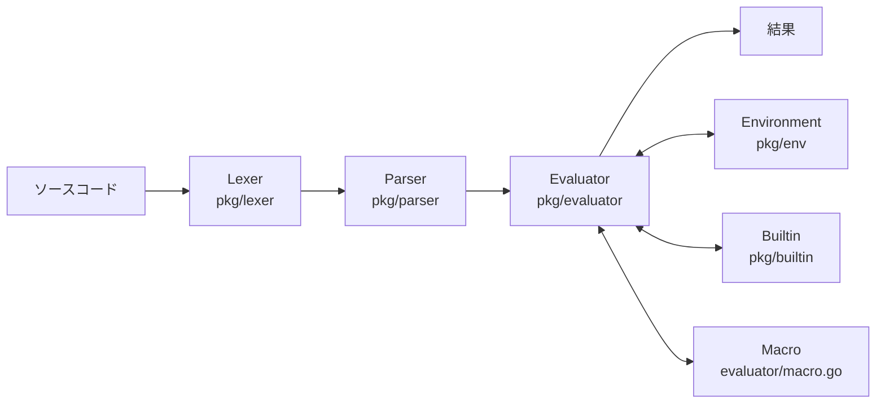

# Sucheme

[](https://github.com/suchi/sucheme-go/actions/workflows/ci.yml)
[]()

## 概要

**Sucheme** は、Go で実装された R7RS 準拠の Scheme インタプリタです。
名前はリポジトリオーナー **suchi** に由来しています（"scheme" のタイポではありません）。

ネイティブバイナリとしても、WebAssembly を通じてブラウザ上でも動作します。

## 特徴

- **R7RS 準拠** — R7RS (small) 仕様に基づいた Scheme インタプリタ
- **衛生的マクロ** — `syntax-rules` による完全なマクロシステム
- **末尾呼び出し最適化 (TCO)** — トランポリン方式による適切な末尾再帰
- **例外処理** — `guard`, `raise`, `with-exception-handler`
- **case-lambda** — 引数数に応じた複数節ディスパッチ
- **パラメータ** — `make-parameter`, `parameterize` による動的束縛
- **ポートI/O** — 文字列ポートによる入出力
- **WebAssembly 対応** — ブラウザ上で動作する Web REPL
- **クロスプラットフォーム** — Linux, macOS, Windows, WebAssembly
- **104個のサンプル** — 基本からアルゴリズムまで10カテゴリ
- **ベンチマーク** — 竹内関数、フィボナッチ等のパフォーマンス測定

## アーキテクチャ



## クイックスタート

### インストール

```bash
go install github.com/suchi/sucheme-go/cmd/sucheme@latest
```

### REPL 起動

```bash
$ sucheme
```

実行例:

```
sucheme> (+ 1 2 3)
6
sucheme> (define (fact n) (if (= n 0) 1 (* n (fact (- n 1)))))
sucheme> (fact 10)
3628800
```

### ファイル実行

```bash
sucheme examples/basics/01-hello.scm
sucheme examples/fibonacci.scm
```

### CLI オプション

```
sucheme                     # REPL モードで起動
sucheme file.scm            # Scheme ファイルを実行
sucheme -e '(+ 1 2)'        # 式を直接評価
sucheme -l lib.scm file.scm # ライブラリを先読みして実行
sucheme -i file.scm         # 実行後REPLに入る
sucheme --version            # バージョン表示
```

## Web UI

ブラウザ上で Sucheme を試せる Web REPL を GitHub Pages で公開しています。

**https://suchi.github.io/sucheme-go/**

## ビルド方法

### ネイティブビルド

```bash
# Linux / macOS
go build -o sucheme ./cmd/sucheme/

# Windows (cmd / PowerShell)
go build -o sucheme.exe ./cmd/sucheme/
```

> **注**: `go install` を使う場合は OS に応じた拡張子が自動付与されるため、`go install github.com/suchi/sucheme-go/cmd/sucheme@latest` がどのプラットフォームでも動作します。

### WASM ビルド

```bash
# Linux / macOS
GOOS=js GOARCH=wasm go build -o web-ui/sucheme.wasm ./cmd/wasm/
# wasm_exec.js をコピー（Go バージョンにより場所が異なる）
cp "$(go env GOROOT)/misc/wasm/wasm_exec.js" web-ui/ 2>/dev/null || \
  cp "$(go env GOROOT)/lib/wasm/wasm_exec.js" web-ui/
```

```powershell
# Windows (PowerShell)
$env:GOOS="js"; $env:GOARCH="wasm"; go build -o web-ui/sucheme.wasm ./cmd/wasm/
$goRoot = go env GOROOT
if (Test-Path "$goRoot/misc/wasm/wasm_exec.js") {
    Copy-Item "$goRoot/misc/wasm/wasm_exec.js" web-ui/
} elseif (Test-Path "$goRoot/lib/wasm/wasm_exec.js") {
    Copy-Item "$goRoot/lib/wasm/wasm_exec.js" web-ui/
} else {
    Write-Error "wasm_exec.js not found in '$goRoot\misc\wasm' or '$goRoot\lib\wasm'."
    exit 1
}
```

> **注意 (PowerShell)**: `$env:GOOS` / `$env:GOARCH` は PowerShell セッションに残り続けます。WASM ビルド後にネイティブビルドを行う場合は、別セッションで実行するか `Remove-Item Env:GOOS, Env:GOARCH` で環境変数を戻してください。

```bat
rem Windows (cmd)
set GOOS=js&& set GOARCH=wasm&& go build -o web-ui/sucheme.wasm ./cmd/wasm/
for /f "delims=" %%G in ('go env GOROOT') do set GOROOT=%%G
if exist "%GOROOT%\misc\wasm\wasm_exec.js" (
  copy "%GOROOT%\misc\wasm\wasm_exec.js" web-ui\
) else if exist "%GOROOT%\lib\wasm\wasm_exec.js" (
  copy "%GOROOT%\lib\wasm\wasm_exec.js" web-ui\
) else (
  echo wasm_exec.js not found under "%GOROOT%\misc\wasm" or "%GOROOT%\lib\wasm" 1>&2
)
```

> **注**: Windows では Git Bash や WSL を使えば Linux と同じコマンドが使えます。ローカルで Web UI を確認するには HTTP サーバー（例: `cd web-ui && python3 -m http.server 8080`）を起動してブラウザでアクセスしてください。

### テスト・ベンチマーク

```bash
go test ./...                                 # テスト
go test -bench=. -benchmem ./pkg/evaluator/   # ベンチマーク
go test -coverprofile=coverage.out ./...      # カバレッジ
```

## プロジェクト構造

```
sucheme-go/
├── cmd/
│   ├── sucheme/       # CLI エントリポイント（REPL, ファイル実行, -e フラグ）
│   └── wasm/          # WebAssembly エントリポイント
├── pkg/
│   ├── types/         # Scheme 値の型定義（Value, Pair, Lambda等）
│   ├── lexer/         # R7RS準拠トークナイザ
│   ├── parser/        # S式パーサ
│   ├── env/           # 環境（スコープチェーン）
│   ├── evaluator/     # 評価器（TCO, マクロ, 例外, ポート, パラメータ）
│   └── builtin/       # 100+ 組み込み関数
├── web-ui/            # Web REPL UI（HTML/CSS/JS）
├── examples/          # 104個のサンプルプログラム（10カテゴリ）
├── docs/              # ドキュメント
│   ├── adr/           # Architecture Decision Records (10件)
│   ├── plans/         # 計画ドキュメント
│   ├── r7rs-compliance.md  # R7RS対応状況（詳細版）
│   ├── CHANGELOG.md        # 開発履歴（時系列）
│   └── onboarding.md       # 開発者オンボーディング
├── .github/workflows/ # CI/CD（テスト, ベンチマーク, Pages, Release）
├── CLAUDE.md          # Claude Code インストラクション
└── SOW.md             # Statement of Work
```

## R7RS 対応状況

> 「対応完了」は関連テストが境界例・特殊例を含めてすべてパスした場合のみ付与。
> 詳細は [docs/r7rs-compliance.md](docs/r7rs-compliance.md) を参照。

| カテゴリ | 項目 | 状況 |
|---------|------|------|
| 基本構文 | `define`, `lambda`, `if`, `cond`, `let`, `let*`, `letrec`, `letrec*`, `begin`, `set!`, `and`, `or`, `when`, `unless`, `do` | 対応完了 |
| クォート | `quote`, `quasiquote`, `unquote`, `unquote-splicing` | 対応完了 |
| マクロ | `syntax-rules`, `define-syntax`, `let-syntax`, `letrec-syntax` | 対応完了 |
| 末尾呼び出し | トランポリン方式 TCO | 対応完了 |
| 例外処理 | `guard`, `raise`, `raise-continuable`, `with-exception-handler`, `error` | 対応完了 |
| case-lambda | 引数数ディスパッチ | 対応完了 |
| パラメータ | `make-parameter`, `parameterize` | 対応完了 |
| 数値 | `+`, `-`, `*`, `/`, `=`, `<`, `>`, `abs`, `min`, `max`, `floor`, `ceiling`, `round`, `expt`, `sqrt` 等 | 対応完了 |
| リスト | `cons`, `car`, `cdr`, `list`, `map`, `filter`, `for-each`, `assoc`, `member` 等 | 対応完了 |
| 文字列 | `string-length`, `string-ref`, `string-append`, `substring` 等 | 対応完了 |
| 文字 | `char->integer`, `char-alphabetic?`, `char-upcase` 等 | 対応完了 |
| ベクタ | `make-vector`, `vector-ref`, `vector-set!` 等 | 対応完了 |
| バイトベクタ | `make-bytevector`, `bytevector-u8-ref` 等 | 対応完了 |
| 等値 | `eq?`, `eqv?`, `equal?`, `boolean=?` | 対応完了 |
| ポートI/O | `open-input-string`, `open-output-string`, `read-char`, `read-line`, `write-char` | 部分対応 |
| 継続 | `call/cc`, `dynamic-wind` | 部分対応 |
| 多値 | `values`, `call-with-values` | 部分対応 |
| ライブラリ | `define-library`, `import`, `export` | 対応完了 |

## サンプルコード

### Hello World

```scheme
(display "Hello, World!")
(newline)
```

### フィボナッチ（末尾再帰）

```scheme
(define (fib-iter n)
  (let loop ((i 0) (a 0) (b 1))
    (if (= i n) a (loop (+ i 1) b (+ a b)))))
(display (fib-iter 30))  ; => 832040
```

### マクロ（while ループ）

```scheme
(define-syntax while
  (syntax-rules ()
    ((while test body ...)
     (let loop ()
       (when test body ... (loop))))))

(define i 0)
(while (< i 5)
  (display i) (display " ")
  (set! i (+ i 1)))
; => 0 1 2 3 4
```

### 例外処理

```scheme
(guard (exn
  ((string? exn) (string-append "Error: " exn)))
  (error "something went wrong"))
; => "Error: something went wrong"
```

### パラメータ（動的束縛）

```scheme
(define p (make-parameter 10))
(display (p))          ; => 10
(parameterize ((p 20))
  (display (p)))       ; => 20
(display (p))          ; => 10
```

104個のサンプルが `examples/` ディレクトリにカテゴリ別に格納されています。

## ドキュメント

- [開発履歴](docs/CHANGELOG.md) — 時系列の開発経緯（PRリンク付き）
- [R7RS 対応状況](docs/r7rs-compliance.md) — 機能ごとの対応状況
- [オンボーディング](docs/onboarding.md) — 開発者向けガイド
- [アーキテクチャ設計](docs/plans/architecture-plan.md) — 技術設計プラン
- [ADR](docs/adr/) — Architecture Decision Records (10件)
- [エンハンスロードマップ](docs/enhancement-roadmap.md) — 将来の機能候補30件
- [SOW](SOW.md) — 作業範囲記述書
- [サンプル](examples/) — 104個の Scheme プログラム

## コントリビューション

1. フォーク → フィーチャーブランチ作成 → 実装 → テスト → PR
2. Conventional Commits（`feat:`, `fix:`, `docs:` 等）
3. PR は GitHub Copilot レビュー通過後にマージ

## ライセンス

NOLICENSE — このプロジェクトにはライセンスが設定されていません。
