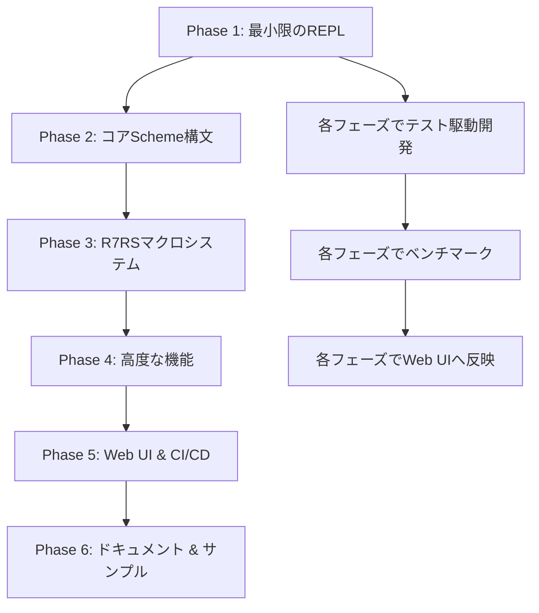

# Sucheme - 作業範囲記述書 (Statement of Work)

## プロジェクト概要

**Sucheme** は、Go で実装する R7RS 準拠の Scheme インタプリタです。
リポジトリオーナー suchi の名前を反映した名前です。

## フェーズ詳細

### Phase 1: 最小限のREPL

- **目標**: 数値リテラル、基本算術演算、REPLループの実現
- **成果物**:
  - Lexer (トークナイザ)
  - Parser (S式パーサ)
  - Evaluator (基本評価器)
  - REPL バイナリ
  - CLI (ファイル実行モード)

### Phase 2: コアScheme構文

- **目標**: R7RS の基本構文をすべて実装
- **成果物**:
  - `define`, `lambda`, `if`, `cond`, `let`, `let*`, `letrec`
  - `quote`, `quasiquote`, `unquote`, `unquote-splicing`
  - `begin`, `set!`, `and`, `or`, `when`, `unless`
  - `do` ループ
  - 適切な末尾呼び出し最適化 (TCO)
  - 基本データ型: boolean, char, string, symbol, pair, vector, bytevector
  - 標準ライブラリ手続き (算術、リスト操作、文字列操作等)

### Phase 3: R7RSマクロシステム

- **目標**: 完全なR7RSマクロ対応
- **成果物**:
  - `syntax-rules` パターンマッチマクロ
  - `define-syntax`, `let-syntax`, `letrec-syntax`
  - 衛生的マクロシステム
  - マクロ展開器

### Phase 4: 高度なR7RS機能

- **目標**: R7RS仕様の残り部分を実装
- **成果物**:
  - 第一級継続 (`call/cc`)
  - 動的束縛 (`dynamic-wind`, `parameterize`)
  - 例外処理 (`guard`, `with-exception-handler`, `raise`)
  - 多値 (`values`, `call-with-values`)
  - ポート / I/O システム
  - ライブラリシステム (`define-library`, `import`, `export`)
  - `eval`, `apply`

### Phase 5: Web UI & CI/CD

- **目標**: WebAssembly ビルド、GitHub Pages デプロイ
- **成果物**:
  - Go の WebAssembly ビルド (GOOS=js GOARCH=wasm)
  - シンプルなWeb REPL UI
  - GitHub Actions CI/CD パイプライン
  - GitHub Pages へのデプロイ (リリース時 & PR時プレビュー)
  - テストカバレッジレポート
  - パフォーマンスベンチマーク (竹内関数含む)

### Phase 6: ドキュメント & サンプル

- **目標**: 学習用資料の整備
- **成果物**:
  - R7RS 対応状況表
  - 100+ サンプルプログラム (基本〜応用〜実用)
  - チュートリアルドキュメント
  - オンボーディングガイド
  - ADR (Architecture Decision Records)

## 技術スタック

| カテゴリ | 技術 |
|---------|------|
| 言語 | Go 1.22+ (stable) |
| WebAssembly | Go WASM (GOOS=js GOARCH=wasm) |
| Web UI | HTML/CSS/JavaScript (フレームワークなし) |
| CI/CD | GitHub Actions |
| テスト | Go 標準テスト + go tool cover |
| ベンチマーク | Go testing.B |
| デプロイ | GitHub Pages |

## 対応プラットフォーム

- Linux (amd64, arm64)
- macOS (amd64, arm64)
- Windows (amd64)
- WebAssembly (js/wasm)

## 品質基準

- テスト駆動開発 (TDD)
- 全コミット時にCIグリーン必須
- コードカバレッジの可視化
- パフォーマンスベンチマークの継続測定
- R7RS準拠度の定量的追跡
