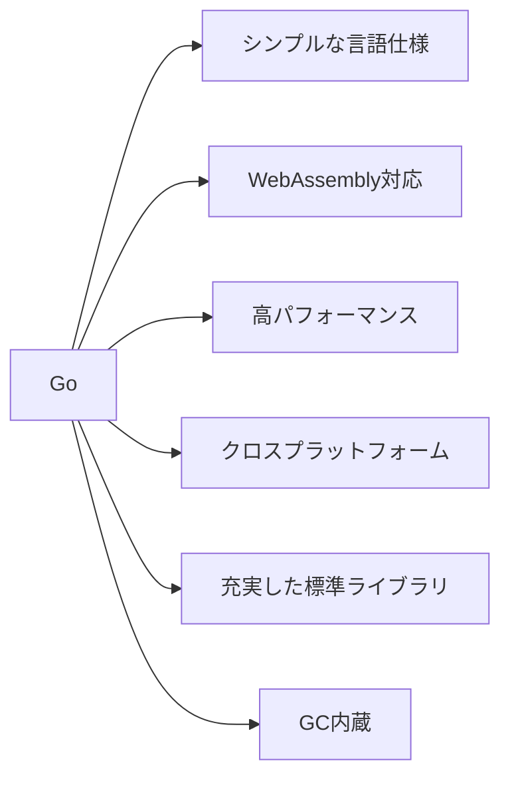

# ADR-001: Scheme インタプリタの実装言語に Go を採用

| 項目 | 値 |
|------|-----|
| 決定日 | 2026-03-27 |
| ステータス | 承認済み（有効） |

## コンテキスト

R7RS 準拠の Scheme インタプリタを実装する言語を選定する必要がある。

## 決定

**Go** を採用する。

## 理由

1. **シンプルな言語仕様**: 学習・保守コストが低い
2. **WebAssembly 対応**: `GOOS=js GOARCH=wasm` で直接コンパイル可能
3. **パフォーマンス**: コンパイル型言語としての十分な実行速度
4. **クロスプラットフォーム**: Linux, macOS, Windows すべてに対応
5. **GC内蔵**: Scheme のメモリ管理をGoのGCに委譲可能
6. **標準ライブラリ**: テスト、ベンチマーク、プロファイリングが標準装備

## 影響

- Go の GC を直接活用するため、Scheme 値のメモリ管理がシンプルになる
- interface{} / any を活用した動的型付きの値表現
- goroutine は Scheme の継続とは直接対応しないため、継続の実装に工夫が必要
