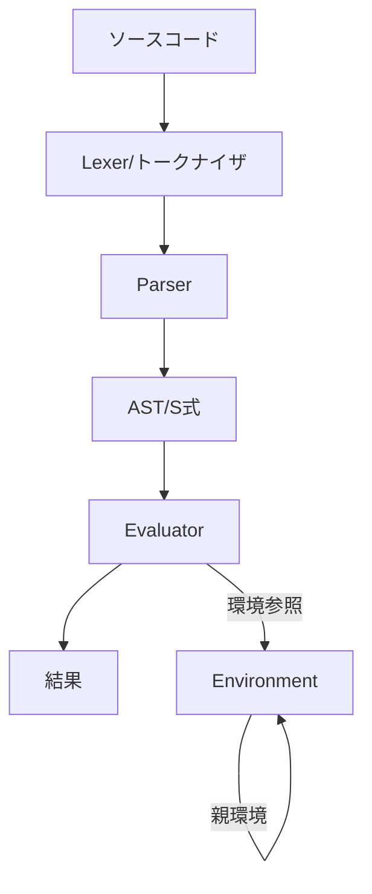

# ADR-002: 評価戦略としてツリーウォーキングインタプリタを採用

| 項目 | 値 |
|------|-----|
| 決定日 | 2026-03-27 |
| ステータス | 承認済み（有効） |
| 将来の変更可能性 | [ADR-006](006-tco-trampoline.md) でTCOを追加。将来的にバイトコードVM移行の可能性あり（[ロードマップ E-12](../enhancement-roadmap.md)） |

## コンテキスト

Scheme インタプリタの評価戦略として、以下の選択肢がある:

1. ツリーウォーキングインタプリタ (AST を直接評価)
2. バイトコードコンパイラ + VM
3. CPS 変換ベース

## 決定

初期実装として **ツリーウォーキングインタプリタ** を採用する。

## 理由

1. **シンプルさ**: 最も実装が容易で、R7RS の意味論と直接対応する
2. **段階的開発**: 機能を一つずつ追加しやすい
3. **デバッグ容易性**: AST レベルでのデバッグが容易
4. **末尾呼び出し最適化**: トランポリン方式で実現可能

## 影響

- バイトコード VM に比べてパフォーマンスは劣る
- 将来的にバイトコードコンパイラへの移行パスを残す
