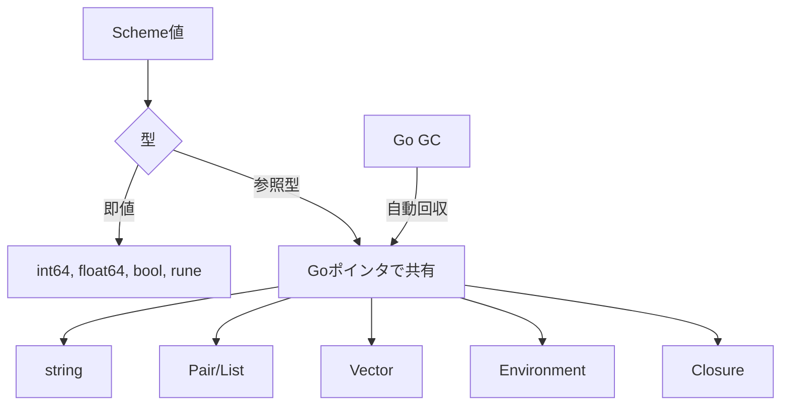

# ADR-003: メモリ管理に Go の GC を活用

## ステータス

承認済み

## コンテキスト

Scheme は動的型付き言語であり、値の共有・循環参照が発生しうる。
メモリ管理戦略を決定する必要がある。

## 決定

Go の標準 GC をそのまま活用する。

## 理由

1. Go の GC は循環参照も正しく回収するため、Scheme の `set-car!`/`set-cdr!` による循環も問題ない
2. 実装がシンプルになる
3. Go のランタイムが最適化された GC を提供している

## 影響

- GC のチューニングは Go ランタイムに依存
- WebAssembly ビルド時にもGoのGCが動作する（バイナリサイズへの影響あり）
