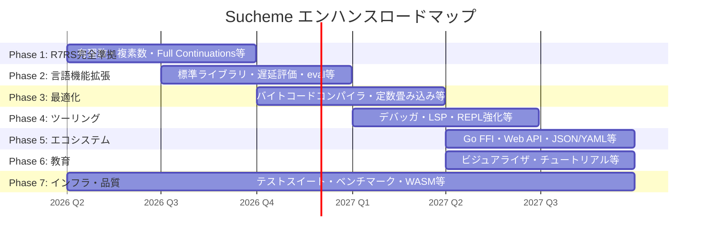

# Sucheme エンハンスロードマップ

## 概要

本ドキュメントは、Sucheme（Go言語で書かれたScheme処理系）の今後のエンハンス候補をまとめたロードマップである。現在のR7RS対応状況は [docs/r7rs-compliance.md](r7rs-compliance.md) を参照しつつ、残りの仕様準拠と新機能の追加を計画的に進める。

### 凡例

- **難易度**: 低（1〜2週間）/ 中（2〜6週間）/ 高（6週間以上）
- **優先度**: 高（次のリリースで対応）/ 中（中期目標）/ 低（長期目標）

---

## Phase 1: R7RS 完全準拠（優先度: 高）

### 1. 有理数（exact rational）の実装

- **概要**: `3/4` のような有理数リテラルの解析・演算を実装する。`numerator`、`denominator`、`rationalize` 等の手続きを追加する。
- **難易度**: 中
- **優先度**: 高
- **依存関係**: レキサーの数値リテラル解析拡張、`pkg/types` への新型追加

### 2. 複素数（complex number）の実装

- **概要**: `3+4i` のような複素数リテラルと、`make-rectangular`、`make-polar`、`real-part`、`imag-part`、`magnitude`、`angle` 等の手続きを実装する。
- **難易度**: 中
- **優先度**: 高
- **依存関係**: 有理数の実装（正確な実部・虚部のため）

### 3. Full Continuations（再入可能継続）

- **概要**: 現在は escape continuation（panic/recover方式）のみ対応。CPS変換またはスタックコピーにより、`call/cc` で取得した継続を複数回呼び出せるようにする。
- **難易度**: 高
- **優先度**: 高
- **依存関係**: evaluator の根本的なリファクタリング、`dynamic-wind` の再入対応

### 4. `dynamic-wind` の再入対応

- **概要**: full continuations と連動し、継続を使って `dynamic-wind` の保護領域に再入する際に before/after サンクを正しく実行する。
- **難易度**: 高
- **優先度**: 高
- **依存関係**: Full Continuations の実装

### 5. `values` の完全な多値対応

- **概要**: 現在は単一値のみ完全対応。`(values 1 2 3)` が `call-with-values` 以外の文脈でも正しく動作するよう、多値の受け渡しを完全にする。
- **難易度**: 中
- **優先度**: 高
- **依存関係**: なし

### 6. I/Oポートの完全対応

- **概要**: `read-char`、`write-char`、`read-line`、`peek-char`、`char-ready?`、`write-string` のデフォルトポートとの統合テストを充実させ、`open-input-file`、`open-output-file` を実装する（WASM環境では仮想ファイルシステムでの代替を検討）。
- **難易度**: 中
- **優先度**: 高
- **依存関係**: なし

### 7. `include-ci` の正確な実装

- **概要**: 現在はソース全体を小文字化しているが、R7RSが要求する「識別子のみのケースフォールド」に修正する。文字列リテラルや文字リテラルは元のケースを維持する。
- **難易度**: 低
- **優先度**: 高
- **依存関係**: レキサーの修正

---

## Phase 2: 言語機能拡張（優先度: 中〜高）

### 8. 末尾呼び出し最適化（TCO）の完全対応

- **概要**: 現在は `if`、`begin` 等の一部フォームでTCOに対応。R7RSが要求するすべての末尾位置（`let`、`cond`、`case`、`when`、`unless`、`guard` 等の本体）でTCOを保証する。
- **難易度**: 中
- **優先度**: 高
- **依存関係**: evaluator のリファクタリング

### 9. R7RS標準ライブラリの完全実装

- **概要**: `(scheme base)` 以外の標準ライブラリ（`(scheme case-lambda)`、`(scheme char)`、`(scheme complex)`、`(scheme cxr)`、`(scheme eval)`、`(scheme file)`、`(scheme inexact)`、`(scheme lazy)`、`(scheme load)`、`(scheme process-context)`、`(scheme read)`、`(scheme repl)`、`(scheme time)`、`(scheme write)`）を個別モジュールとして実装する。
- **難易度**: 高
- **優先度**: 中
- **依存関係**: ライブラリシステム（実装済み）、各種基盤機能

### 10. 遅延評価（`delay` / `force` / `delay-force`）

- **概要**: R7RSのプロミス機構を実装する。`(scheme lazy)` ライブラリとして `make-promise`、`promise?` も含める。
- **難易度**: 低
- **優先度**: 中
- **依存関係**: なし

### 11. `eval` と `environment` の実装

- **概要**: `(eval expr environment)` による動的評価と、`(environment import-set ...)` による評価環境の構築を実装する。
- **難易度**: 中
- **優先度**: 中
- **依存関係**: ライブラリシステム

### 12. `syntax-case` / `er-macro-transformer`

- **概要**: `syntax-rules` に加え、より低レベルなマクロシステム（`syntax-case` や Explicit Renaming マクロ）を実装する。これにより、ユーザーが高度なマクロを定義できるようになる。
- **難易度**: 高
- **優先度**: 低
- **依存関係**: マクロシステム（実装済み）

---

## Phase 3: 最適化・パフォーマンス（優先度: 中）

### 13. バイトコードコンパイラ

- **概要**: 現在のツリーウォーキングインタプリタを、中間バイトコード表現にコンパイルしてからVM上で実行する方式に変更する。実行速度の大幅な向上が見込める。
- **難易度**: 高
- **優先度**: 中
- **依存関係**: Full Continuations の設計と整合性が必要

### 14. 定数畳み込み・インライン展開

- **概要**: コンパイル時に定数式を事前計算し、小さな関数をインライン展開する最適化パスを追加する。
- **難易度**: 中
- **優先度**: 中
- **依存関係**: バイトコードコンパイラ（推奨だが独立実装も可能）

### 15. ガベージコレクションの改善

- **概要**: GoのGCに依存している現在の方式から、Scheme値専用のメモリプールやジェネレーショナルGCの導入を検討する。大量のcons割り当てに対するパフォーマンスを改善する。
- **難易度**: 高
- **優先度**: 低
- **依存関係**: バイトコードコンパイラ

### 16. プロファイラの実装

- **概要**: Schemeプログラムの実行時プロファイリング機能を追加する。関数ごとの呼び出し回数・実行時間・メモリ割り当て量を計測し、ホットスポットを特定できるようにする。
- **難易度**: 中
- **優先度**: 中
- **依存関係**: なし

---

## Phase 4: ツーリング（優先度: 中）

### 17. ステップ実行デバッガ

- **概要**: Schemeプログラムをステップ実行し、各評価ステップでの環境・スタックを確認できるデバッガを実装する。CLI（REPLコマンド）とWeb UI（ビジュアル）の両方に対応する。
- **難易度**: 中
- **優先度**: 中
- **依存関係**: evaluator へのフック機構の追加

### 18. LSP (Language Server Protocol) サーバー

- **概要**: エディタ（VS Code等）向けのLSPサーバーを実装する。シンタックスハイライト、補完、定義ジャンプ、ホバー時のドキュメント表示、診断（エラー・警告）を提供する。
- **難易度**: 高
- **優先度**: 中
- **依存関係**: パーサーのエラーリカバリ改善

### 19. REPL の強化

- **概要**: タブ補完および括弧の自動マッチングを実装し、対話的なコーディング体験を向上させる。（注: 履歴検索、vi/emacsキーバインド、履歴永続化はPR #19で実装済み）
- **難易度**: 低
- **優先度**: 高
- **依存関係**: なし

### 20. パッケージマネージャ

- **概要**: サードパーティのSchemeライブラリを管理するパッケージマネージャを実装する。Git リポジトリやレジストリからのライブラリ取得、バージョン管理、依存解決を行う。
- **難易度**: 高
- **優先度**: 低
- **依存関係**: R7RS標準ライブラリの完全実装

---

## Phase 5: エコシステム・外部連携（優先度: 中〜低）

### 21. Go FFI（Foreign Function Interface）

- **概要**: SchemeからGoの関数やパッケージを直接呼び出せるFFI機構を実装する。Go側のプラグイン機構やreflect パッケージを活用し、型の自動変換を行う。
- **難易度**: 高
- **優先度**: 中
- **依存関係**: 型システムの拡張

### 22. Web API サーバー機能

- **概要**: Schemeで記述したハンドラをHTTP APIとして公開する機能を実装する。`(define-handler "/api/hello" (lambda (req) ...))` のようなDSLで簡潔にAPIを定義できるようにする。
- **難易度**: 中
- **優先度**: 低
- **依存関係**: Go FFI（推奨）、I/Oポートの完全対応

### 23. データベース連携

- **概要**: SQLite等の軽量データベースへのアクセス手続きを提供する。`(db-open "file.db")`、`(db-query db "SELECT ...")`のようなインターフェースを実装する。
- **難易度**: 中
- **優先度**: 低
- **依存関係**: Go FFI

### 24. JSON / YAML パーサー

- **概要**: JSON/YAMLの読み書きを行うライブラリを提供する。`(json-read port)` でSchemeのリスト/ベクタに変換し、`(json-write obj port)` でシリアライズする。
- **難易度**: 低
- **優先度**: 中
- **依存関係**: I/Oポートの完全対応

---

## Phase 6: 教育・ビジュアライゼーション（優先度: 中）

### 25. ステップ実行ビジュアライザ（Web UI）

- **概要**: Web UI上で Scheme プログラムの評価過程をアニメーション付きでビジュアライズする。AST、環境フレーム、スタックの状態をリアルタイムに表示し、前進・後退が可能なタイムトラベルデバッグを実現する。
- **難易度**: 高
- **優先度**: 中
- **依存関係**: ステップ実行デバッガ、Web UI の拡張

### 26. インタラクティブチュートリアル

- **概要**: Web UI上に組み込みのSchemeチュートリアルを実装する。段階的な課題を出し、ユーザーがREPLで解答を入力すると自動的に正誤判定を行う。Schemeの基礎からマクロ・継続までカバーする。
- **難易度**: 中
- **優先度**: 中
- **依存関係**: Web UIの拡張

### 27. エラーメッセージの改善

- **概要**: 初心者に分かりやすいエラーメッセージを提供する。エラー発生箇所のソース位置（行番号・列番号）表示、「もしかして（did you mean）」サジェスト、よくある間違いに対するヒントを実装する。
- **難易度**: 中
- **優先度**: 高
- **依存関係**: レキサー・パーサーのソース位置追跡の改善

---

## Phase 7: インフラ・品質（優先度: 中）

### 28. R7RS テストスイートの統合

- **概要**: Chibi-Scheme等の既存R7RSテストスイート（r7rs-tests）をCI に統合し、仕様準拠度を客観的に計測・追跡する。
- **難易度**: 低
- **優先度**: 高
- **依存関係**: なし

### 29. ベンチマークスイートの充実

- **概要**: Gambit benchmarks や Larceny benchmarks 等の標準Schemeベンチマークを導入し、リリースごとのパフォーマンス推移をダッシュボードで可視化する。
- **難易度**: 低
- **優先度**: 中
- **依存関係**: なし

### 30. WASM ビルドの最適化

- **概要**: WebAssemblyバイナリのサイズ最適化（TinyGo検討、不要パッケージの除去）、起動時間の短縮、ブラウザ上でのファイルI/Oエミュレーション（IndexedDBベースの仮想FS）を実装する。
- **難易度**: 中
- **優先度**: 中
- **依存関係**: なし

---

## 優先順位サマリー

| 優先度 | 項目 |
|--------|------|
| **高** | #1 有理数, #2 複素数, #3 Full Continuations, #4 dynamic-wind再入, #5 多値完全対応, #6 I/O完全対応, #7 include-ci修正, #8 TCO完全対応, #19 REPL強化, #27 エラーメッセージ改善, #28 R7RSテストスイート |
| **中** | #9 標準ライブラリ, #10 遅延評価, #11 eval/environment, #13 バイトコードコンパイラ, #14 定数畳み込み, #16 プロファイラ, #17 デバッガ, #18 LSP, #21 Go FFI, #24 JSON/YAML, #25 ビジュアライザ, #26 チュートリアル, #29 ベンチマーク, #30 WASM最適化 |
| **低** | #12 syntax-case, #15 GC改善, #20 パッケージマネージャ, #22 Web API, #23 DB連携 |

---

## ロードマップタイムライン（目安）

> 注: タイムラインは開発リソースに応じて調整する。各フェーズ内の項目は並行して進めることが可能。
