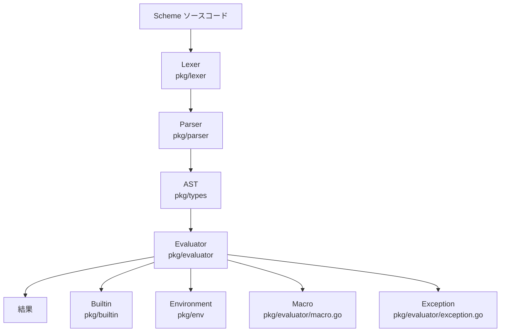
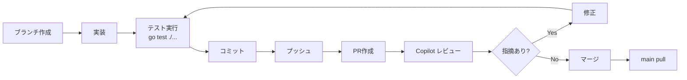

# Sucheme 開発者オンボーディングガイド

## プロジェクト概要

Sucheme は Go で実装された R7RS 準拠の Scheme インタプリタ。「suchi」の名前を反映した名称で、typo ではない。



## クイックスタート

### 前提条件

- Go 1.24+
- Git

### ビルドとテスト

```bash
# リポジトリクローン
git clone https://github.com/suchi/sucheme-go.git
cd sucheme-go

# 全テスト実行
go test ./... -v

# CLI ビルド
go build -o sucheme ./cmd/sucheme/

# REPL 起動
./sucheme

# ファイル実行
./sucheme examples/hello.scm

# 式の評価
./sucheme -e '(+ 1 2 3)'

# WASM ビルド
GOOS=js GOARCH=wasm go build -o web-ui/sucheme.wasm ./cmd/wasm/

# ベンチマーク
go test -bench=. -benchmem ./pkg/evaluator/

# カバレッジ
go test -coverprofile=coverage.out ./...
go tool cover -html=coverage.out
```

## プロジェクト構造

```
sucheme-go/
├── cmd/
│   ├── sucheme/          # CLI エントリポイント
│   │   └── main.go       #   REPL、ファイル実行、-e フラグ
│   └── wasm/             # WASM エントリポイント
│       └── main.go       #   suchemeEval/suchemeReset をJS公開
├── pkg/
│   ├── types/            # Scheme 値の型定義
│   │   ├── types.go      #   Value, Pair, Lambda, SyntaxRules 等
│   │   └── types_test.go
│   ├── lexer/            # トークナイザ
│   │   ├── lexer.go      #   R7RS 準拠のトークン分割
│   │   └── lexer_test.go
│   ├── parser/           # S式パーサ
│   │   ├── parser.go     #   トークン → Value AST 変換
│   │   └── parser_test.go
│   ├── env/              # 環境（スコープチェーン）
│   │   ├── env.go        #   Define/Set!/Get/Extend
│   │   └── env_test.go
│   ├── evaluator/        # 評価器
│   │   ├── evaluator.go  #   TCOトランポリン、特殊形式
│   │   ├── macro.go      #   syntax-rules マクロ展開
│   │   ├── exception.go  #   例外処理、case-lambda
│   │   ├── evaluator_test.go
│   │   ├── macro_test.go
│   │   ├── exception_test.go
│   │   └── bench_test.go #   パフォーマンスベンチマーク
│   └── builtin/          # 組み込み関数
│       ├── builtin.go    #   70+ 関数の登録
│       └── builtin_test.go
├── web-ui/               # Web REPL
│   ├── index.html
│   ├── style.css
│   └── app.js
├── examples/             # サンプルプログラム
├── docs/                 # ドキュメント
│   ├── adr/              #   Architecture Decision Records
│   ├── architecture-plan.md
│   ├── r7rs-compliance.md
│   └── onboarding.md     #   このファイル
├── .github/
│   ├── workflows/        #   CI/CD
│   └── copilot-instructions.md
├── CLAUDE.md             # Claude Code インストラクション
├── SOW.md                # Statement of Work
├── Makefile
└── go.mod
```

## 開発フロー



### ルール

1. **テスト駆動**: テストを先に書いてから実装
2. **Conventional Commits**: `feat:`, `fix:`, `test:`, `docs:` 等
3. **コミットメッセージ**: 1行目は英語、説明文は日本語
4. **PR**: Copilot レビュー完了後にマージ
5. **1機能あたり10〜50のテストケース**

## 主要な型

### Value (pkg/types/types.go)

```go
type Value struct {
    Type      ValueType     // 型タグ
    IntVal    int64         // TypeInteger
    FloatVal  float64       // TypeFloat
    BoolVal   bool          // TypeBoolean
    CharVal   rune          // TypeCharacter
    StrVal    string        // TypeString
    SymbolVal string        // TypeSymbol
    PairVal   *Pair         // TypePair
    VecVal    []*Value      // TypeVector
    ProcVal   *Procedure    // TypeProcedure
    ByteVec   []byte        // TypeBytevector
    ValuesVal []*Value      // TypeValues
    SyntaxVal *SyntaxRules  // TypeSyntaxRules
}
```

### 環境初期化パターン

```go
e := env.Global()
builtin.RegisterBuiltins(e)
evaluator.RegisterApply(e)
evaluator.RegisterExceptionBuiltins(e)
evaluator.RegisterMapForEach(e)
```

## AI ツール向けインストラクション

このリポジトリは以下の AI ツールで開発可能:

- **Claude Code**: `CLAUDE.md` にインストラクションあり
- **GitHub Copilot**: `.github/copilot-instructions.md` にインストラクションあり
- **Codex/その他**: 上記ファイルを参照

### 共通ルール

- 応答・説明は日本語
- コミットメッセージは英語（Conventional Commits）
- ソースコード内のメッセージ（エラー文、ログ等）は英語
- テストは1機能あたり10〜50のケース
- PR は Copilot レビュー完了後にマージ
