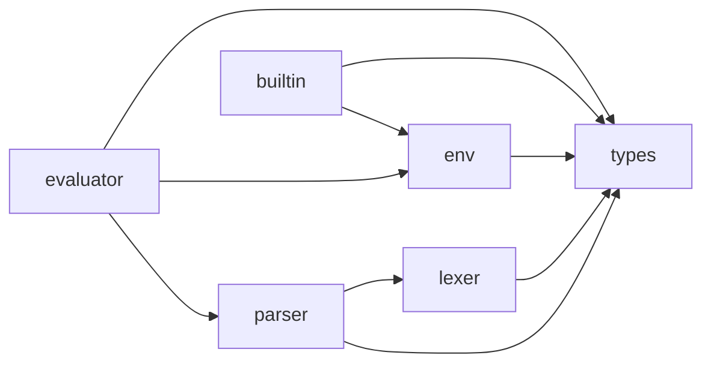

# Sucheme 開発者オンボーディングガイド

このドキュメントは、Sucheme プロジェクトに新しく参加する開発者（人間および Coding Agent）向けのオンボーディングガイドです。プロジェクトの全体像を素早く把握し、開発を始められるようにすることを目的としています。

> 既存の詳細ドキュメントとの重複を避けるため、詳細は各ドキュメントへのリンクで参照してください。

---

## 目次

1. [プロジェクト概要](#プロジェクト概要)
2. [環境構築](#環境構築)
3. [ディレクトリ構造とパッケージ](#ディレクトリ構造とパッケージ)
4. [アーキテクチャ](#アーキテクチャ)
5. [開発ワークフロー](#開発ワークフロー)
6. [テストの書き方と実行方法](#テストの書き方と実行方法)
7. [ビルドとデプロイ](#ビルドとデプロイ)
8. [Coding Agent 向けの注意事項](#coding-agent-向けの注意事項)
9. [よくある開発タスクの例](#よくある開発タスクの例)
10. [トラブルシューティング](#トラブルシューティング)

---

## プロジェクト概要

**Sucheme** は Go で実装された R7RS (Revised^7 Report on the Algorithmic Language Scheme) 準拠の Scheme インタプリタです。名前はリポジトリオーナー **suchi** に由来しています（"scheme" のタイポではありません）。

主な特徴:
- R7RS (small) 仕様に基づいたインタプリタ
- トランポリン方式による末尾呼び出し最適化 (TCO)
- `syntax-rules` による衛生的マクロ
- 例外処理 (`guard`, `raise`, `with-exception-handler`)
- `case-lambda` による引数数ディスパッチ
- `make-parameter` / `parameterize` による動的束縛
- 文字列ポートによる I/O
- WebAssembly 対応（ブラウザ上で動作する Web REPL）
- 100以上のビルトイン関数、104個のサンプルプログラム
- 外部依存なし（Go 標準ライブラリのみ使用）

現在の R7RS 対応状況は [docs/r7rs-compliance.md](r7rs-compliance.md) を参照してください。

### ライセンス

**NOLICENSE**（ライセンスなし）。MIT やその他のライセンスを記載しないでください。

---

## 環境構築

### 前提条件

- **Go 1.24.7+** (`go.mod` で指定)
- **Git**

### 手順

```bash
# 1. リポジトリをクローン
git clone https://github.com/suchi/sucheme-go.git
cd sucheme-go

# 2. テストを実行して環境確認
go test ./...

# 3. CLI バイナリをビルド
go build -o sucheme ./cmd/sucheme/

# 4. REPL を起動して動作確認
./sucheme
# sucheme> (+ 1 2 3)
# 6
# sucheme> (exit)

# 5. ファイルを実行
./sucheme examples/hello.scm
./sucheme -e '(+ 1 2)'
```

### WASM ビルド（Web UI 開発時）

```bash
# WASM バイナリをビルド
GOOS=js GOARCH=wasm go build -o web-ui/sucheme.wasm ./cmd/wasm/

# Go ランタイムの wasm_exec.js をコピー
cp "$(go env GOROOT)/misc/wasm/wasm_exec.js" web-ui/

# ローカル HTTP サーバを起動して Web UI を確認
cd web-ui
python -m http.server 8000
# ブラウザで http://localhost:8000/index.html を開いて確認
```

Windows の場合、WASM ビルドは Git Bash や WSL 上で実行してください。

### Makefile

よく使うコマンドは `Makefile` にまとめられています:

```bash
make build   # ネイティブビルド
make test    # テスト実行（-v 付き）
make bench   # ベンチマーク
make cover   # カバレッジレポート生成
make wasm    # WASM ビルド + wasm_exec.js コピー
make clean   # ビルド成果物の削除
```

---

## ディレクトリ構造とパッケージ

```
sucheme-go/
├── cmd/
│   ├── sucheme/           # CLI エントリポイント
│   │   └── main.go        #   REPL、ファイル実行、-e/-l/-i/-q/--version フラグ
│   └── wasm/              # WebAssembly エントリポイント
│       └── main.go        #   suchemeEval/suchemeReset を JS に公開
├── pkg/
│   ├── types/             # Scheme 値の型定義（全パッケージの基盤）
│   ├── lexer/             # R7RS 準拠トークナイザ
│   ├── parser/            # S式パーサ（トークン列 → Value AST）
│   ├── env/               # 環境（スコープチェーン）
│   ├── evaluator/         # 評価器（TCO、特殊形式、マクロ、例外、ポート、パラメータ）
│   └── builtin/           # 100+ 組み込み関数
├── web-ui/                # Web REPL（HTML/CSS/JS）
│   ├── index.html         #   UI レイアウト
│   ├── style.css          #   スタイル
│   └── app.js             #   WASM 読み込み、suchemeEval()/suchemeReset() 呼び出し
├── examples/              # 104個のサンプルプログラム（10カテゴリ）
│   ├── basics/            #   基本構文
│   ├── algorithms/        #   アルゴリズム
│   ├── data-structures/   #   データ構造
│   ├── higher-order/      #   高階関数
│   ├── macros/            #   マクロ
│   ├── math/              #   数学
│   ├── patterns/          #   デザインパターン
│   ├── practical/         #   実用的な例
│   ├── puzzles/           #   パズル
│   ├── strings/           #   文字列処理
│   └── *.scm              #   ルート直下のクラシック例（factorial, fibonacci, tak 等）
├── docs/                  # ドキュメント
│   ├── adr/               #   Architecture Decision Records (3件)
│   ├── architecture-plan.md
│   ├── r7rs-compliance.md
│   ├── phase4-plan.md
│   └── onboarding.md      #   このファイル
├── .github/workflows/     # CI/CD
│   ├── ci.yml             #   テスト(3OS)、カバレッジ、ベンチマーク、WASM ビルド
│   ├── pages.yml          #   GitHub Pages デプロイ（Web REPL）
│   └── release.yml        #   タグリリース（マルチプラットフォーム）
├── CLAUDE.md              # Claude Code インストラクション
├── SOW.md                 # Statement of Work
├── Makefile
└── go.mod                 # 外部依存なし（標準ライブラリのみ）
```

### パッケージの役割と依存関係

| パッケージ | 役割 | 依存先 |
|-----------|------|--------|
| `pkg/types` | Scheme 値の型定義（`Value`, `Pair`, `Lambda`, `SyntaxRules` 等）。全パッケージの基盤 | なし |
| `pkg/lexer` | ソースコードをトークン列に分割 | `types` |
| `pkg/parser` | トークン列を `Value` の AST に変換 | `types`, `lexer` |
| `pkg/env` | 環境（スコープチェーン）。`Define`, `Set`, `Get`, `Extend` を提供 | `types` |
| `pkg/evaluator` | 評価器コア。TCO トランポリン、特殊形式、マクロ展開、例外処理、ポートI/O、パラメータ | `types`, `env`, `parser` |
| `pkg/builtin` | 100以上の組み込み関数（算術、リスト、文字列、文字、ベクタ、バイトベクタ、I/O 等） | `types`, `env` |

依存関係の方向:



> **注意**: `builtin` は `evaluator` に依存しません。`evaluator.Eval` を呼ぶ必要がある関数は `evaluator` パッケージ内の `Register*` 関数として実装されています。

**循環依存の回避**: `types` パッケージが `Env` インターフェースを定義し、`env` パッケージがそれを実装することで循環依存を防いでいます。また、`evaluator.Eval` を呼ぶ必要があるビルトイン関数（`apply`, `map`, `for-each` 等）は `pkg/builtin` ではなく `pkg/evaluator` に `Register*` 関数として配置されています。

### evaluator パッケージのファイル構成

`pkg/evaluator/` は最も大きいパッケージで、以下のファイルに分割されています:

| ファイル | 内容 |
|---------|------|
| `evaluator.go` | 評価器コア（`Eval`, `evalTCO`, 全特殊形式、関数適用、`EvalString`, `RegisterApply`, `RegisterMapForEach`） |
| `macro.go` | `syntax-rules` マクロのパターンマッチとテンプレート展開 |
| `exception.go` | 例外処理（`raise`, `guard`, `with-exception-handler`）、`case-lambda`, `RegisterExceptionBuiltins` |
| `parameter.go` | パラメータオブジェクト（`make-parameter`, `parameterize`）、`RegisterParameterBuiltins` |
| `port.go` | ポートI/O（`open-input-string`, `read-char`, `write-char` 等）、`RegisterPortBuiltins` |
| `bench_test.go` | パフォーマンスベンチマーク |

---

## アーキテクチャ

### データフローと処理パイプライン

```
ソースコード (文字列)
    |
    v
  Lexer (pkg/lexer)        トークン列に分割
    |
    v
  Parser (pkg/parser)      トークン列 → Value (AST) に変換
    |
    v
  Evaluator (pkg/evaluator)
    |
    +--- 自己評価式 (数値, 文字列, etc.) → そのまま返す
    +--- シンボル → 環境 (pkg/env) から変数を探索
    +--- 特殊形式 (if, define, lambda, etc.) → 専用の eval 関数で処理
    +--- マクロ → syntax-rules で展開してから再評価
    +--- 関数適用 → 引数を評価し、関数を呼び出す
              |
              +--- ビルトイン関数 (pkg/builtin) → Go の関数を直接呼び出し
              +--- ユーザー定義関数 (Lambda) → 新しい環境でボディを評価
    |
    v
  結果 (*types.Value)
```

### 末尾呼び出し最適化 (TCO)

トランポリン方式を採用しています。末尾位置の式は値ではなく `thunk`（式+環境のペア）を返し、メインループが `thunk` がなくなるまで繰り返し評価します:

```go
type thunk struct {
    expr *types.Value
    env  *env.Env
}

type evalResult struct {
    value *types.Value  // 最終値（thunk が nil の場合）
    thunk *thunk        // non-nil → 継続評価が必要
}

func Eval(expr *types.Value, e *env.Env) (*types.Value, error) {
    result, err := evalTCO(expr, e)
    if err != nil {
        return nil, err
    }
    for result.thunk != nil {
        result, err = evalTCO(result.thunk.expr, result.thunk.env)
        if err != nil {
            return nil, err
        }
    }
    return result.value, nil
}
```

末尾位置にある式（`if` の分岐、`begin` の最後の式、`let` のボディの最後の式など）は `resultThunk(expr, env)` を返すことで TCO が実現されます。非末尾位置では `Eval(expr, e)` を呼びます。

### 特殊形式のディスパッチ

`evalList` 関数がリスト式の先頭シンボルで switch して各特殊形式の eval 関数にディスパッチします:

```go
func evalList(expr *types.Value, e *env.Env) (*evalResult, error) {
    head := expr.PairVal.Car
    if head.Type == types.TypeSymbol {
        switch head.SymbolVal {
        case "quote":  return evalQuote(expr)
        case "if":     return evalIf(expr, e)
        case "define": return evalDefine(expr, e)
        case "lambda": return evalLambda(expr, e)
        // ... 他の特殊形式
        }
        // マクロチェック
        if val, ok := e.Get(head.SymbolVal); ok && val.Type == types.TypeSyntaxRules {
            expanded, err := expandMacro(val.SyntaxVal, expr)
            if err != nil {
                return nil, err
            }
            return resultThunk(expanded, e), nil  // 展開結果を再評価
        }
    }
    return evalApplication(expr, e)  // 通常の関数適用
}
```

### 環境の初期化

CLI と WASM の両方で、環境は以下の順序で初期化されます:

```go
e := env.Global()                       // 空のグローバル環境を作成
builtin.RegisterBuiltins(e)             // 算術、リスト、文字列等の組み込み関数を登録
evaluator.RegisterApply(e)              // apply を登録
evaluator.RegisterExceptionBuiltins(e)  // raise, guard, with-exception-handler 等
evaluator.RegisterMapForEach(e)         // map, for-each, filter
evaluator.RegisterParameterBuiltins(e)  // make-parameter
evaluator.RegisterPortBuiltins(e)       // ポートI/O関数
// display, write, newline は CLI/WASM で異なる実装を登録
```

`display` / `write` / `newline` は CLI では標準出力に書き込み、WASM では `strings.Builder` にキャプチャする実装になっており、それぞれ `cmd/sucheme/main.go` と `cmd/wasm/main.go` で登録されます。

### コアデータ型: Value

Scheme の値はすべて `*types.Value` で表現されます。タグ付きユニオン方式で、`Type` フィールドが型を示し、対応するフィールドに値が格納されます。

主なコンストラクタ:

| コンストラクタ | 用途 |
|--------------|------|
| `types.NewInteger(42)` | 整数 |
| `types.NewFloat(3.14)` | 浮動小数点数 |
| `types.NewBoolean(true)` | 真偽値（`types.True`, `types.False` も利用可） |
| `types.NewString("hello")` | 文字列 |
| `types.NewSymbol("foo")` | シンボル |
| `types.NewChar('a')` | 文字 |
| `types.Cons(car, cdr)` | ペア（コンスセル） |
| `types.FromList(vals)` | スライスからプロパーリストを構築 |
| `types.NewVector(elems)` | ベクタ |
| `types.NewBytevector(b)` | バイトベクタ |
| `types.NewProcedure(name, fn)` | ビルトイン手続き |
| `types.NewLambdaProcedure(name, lam)` | ユーザー定義手続き |
| `types.Nil()` | 空リスト |
| `types.Void()` | void（副作用のみの式の戻り値） |

詳細は [docs/architecture-plan.md](architecture-plan.md) を参照してください。

---

## 開発ワークフロー

### ブランチ戦略

1. `main` ブランチから**フィーチャーブランチ**を作成（`feature/*` または `claude/*`）
2. フィーチャーブランチで開発・テスト・コミット
3. PR を `main` に向けて作成
4. GitHub Copilot レビューを受けて修正
5. レビュー承認後にマージ
6. マージ後、`main` を pull して次のフィーチャーブランチを切る

### コミットルール

- **Conventional Commits** に従う: `feat:`, `fix:`, `docs:`, `test:`, `chore:`, `refactor:`
- 1行目は**英語の命令形** (例: `feat: add unit tests for lexer`)
- 2行目以降の説明文は**日本語**で記述
- **コミット前に `go test ./...` を必ず実行**する
- 1つのコミットは1つの論理的な変更に対応

### PR/レビュー手順（厳守）

以下の手順は省略・スキップ厳禁です:

1. フィーチャーブランチでコミット & プッシュ
2. PR を `main` に向けて作成（本文に `\n` リテラルを使わず実際の改行を使う）
3. GitHub Copilot にレビューを依頼
4. **レビュー完了を確認**（最低 60 秒は待機）
5. レビューコメントがあれば**すべて修正** → 再コミット & プッシュ → 再度レビュー依頼 → 手順4へ
6. レビューコメントなし（No New Comment）を**確認してから**マージ
7. マージ後、`main` を pull して次のフィーチャーブランチを切る

**禁止事項**: レビュー未完了でのマージは厳禁。「時間がかかっている」「おそらく問題ない」等の理由でスキップしてはならない。

### コミュニケーション言語

| 対象 | 言語 |
|------|------|
| 応答・説明・ドキュメント | 日本語 |
| コミットメッセージ 1行目 | 英語（命令形） |
| コミットメッセージ説明文 | 日本語 |
| ソースコード内メッセージ（エラー文等） | 英語 |
| GoDoc コメント / パッケージコメント | 英語 |

---

## テストの書き方と実行方法

### 実行コマンド

```bash
go test ./...                              # 全テスト実行
go test ./... -v                           # 詳細出力
go test -run TestAdd ./pkg/builtin/        # 特定テストを実行
go test -coverprofile=coverage.out ./...   # カバレッジ付き
go tool cover -html=coverage.out -o coverage.html # カバレッジレポートを生成
go test -bench=. -benchmem ./pkg/evaluator/ # ベンチマーク
```

### テスト品質基準

- **1機能あたり 10〜50 のテストケース**
- **正常系**: 基本的な使用パターン
- **異常系**: 不正な引数、型エラー、未定義変数
- **境界例**: ゼロ、空リスト、最大値、最小値、型の境界
- テスト不足の機能を R7RS 対応表で「対応完了」にしてはならない

### テストパターン

#### パターン A: ビルトイン関数のテスト (`pkg/builtin/builtin_test.go`)

環境をセットアップし、`BuiltinFunc` を直接呼び出すパターン:

```go
func setup() *env.Env {
    e := env.Global()
    RegisterBuiltins(e)
    return e
}

// ヘルパー: 関数を呼び出して結果を返す
func call(t *testing.T, e *env.Env, name string, args ...*types.Value) *types.Value {
    t.Helper()
    v, ok := e.Get(name)
    if !ok { t.Fatalf("builtin %q not found", name) }
    result, err := v.ProcVal.Builtin(args)
    if err != nil { t.Fatalf("%s: unexpected error: %v", name, err) }
    return result
}

// ヘルパー: エラーを期待する呼び出し
func callErr(t *testing.T, e *env.Env, name string, args ...*types.Value) error {
    t.Helper()
    v, ok := e.Get(name)
    if !ok { t.Fatalf("builtin %q not found", name) }
    _, err := v.ProcVal.Builtin(args)
    return err
}

func TestAdd(t *testing.T) {
    e := setup()
    tests := []struct {
        args   []*types.Value
        expect int64
    }{
        {nil, 0},
        {[]*types.Value{types.NewInteger(1)}, 1},
        {[]*types.Value{types.NewInteger(1), types.NewInteger(2)}, 3},
    }
    for _, tt := range tests {
        result := call(t, e, "+", tt.args...)
        if result.IntVal != tt.expect {
            t.Errorf("(+ %v) = %d, want %d", tt.args, result.IntVal, tt.expect)
        }
    }
}
```

#### パターン B: 評価器のテスト (`pkg/evaluator/evaluator_test.go`)

Scheme の式を文字列で渡して結果を検証するパターン:

```go
func setupEval() *env.Env {
    e := env.Global()
    builtin.RegisterBuiltins(e)
    RegisterApply(e)
    RegisterExceptionBuiltins(e)
    RegisterMapForEach(e)
    RegisterParameterBuiltins(e)
    RegisterPortBuiltins(e)
    return e
}

// ヘルパー: 式を評価して結果を返す
func evalHelper(t *testing.T, input string) *types.Value {
    t.Helper()
    e := setupEval()
    result, err := EvalString(input, e)
    if err != nil { t.Fatalf("unexpected error evaluating %q: %v", input, err) }
    return result
}

// ヘルパー: エラーを期待する評価
func evalErr(t *testing.T, input string) error {
    t.Helper()
    e := setupEval()
    _, err := EvalString(input, e)
    return err
}

func TestSomeFeature(t *testing.T) {
    tests := []struct {
        input  string
        expect string
    }{
        {"(if #t 1 2)", "1"},
        {"(if #f 1 2)", "2"},
        {"(if 0 1 2)", "1"},   // Scheme では 0 は真
    }
    for _, tt := range tests {
        t.Run(tt.input, func(t *testing.T) {
            r := evalHelper(t, tt.input)
            if r.String() != tt.expect {
                t.Errorf("got %s, want %s", r.String(), tt.expect)
            }
        })
    }
}
```

#### パターン C: 環境を共有する連続評価

`define` で変数を定義し、後続の式で参照する場合:

```go
func TestDefineAndUse(t *testing.T) {
    e := setupEval()
    evalWithEnv(t, "(define x 10)", e)
    r := evalWithEnv(t, "(+ x 5)", e)
    if r.String() != "15" {
        t.Errorf("got %s, want 15", r.String())
    }
}
```

---

## ビルドとデプロイ

### ネイティブビルド

```bash
go build -o sucheme ./cmd/sucheme/
```

バージョン付きビルド:
```bash
go build -ldflags="-s -w -X main.Version=v1.0.0" -o sucheme ./cmd/sucheme/
```

### WASM ビルド

```bash
GOOS=js GOARCH=wasm go build -o web-ui/sucheme.wasm ./cmd/wasm/
cp "$(go env GOROOT)/misc/wasm/wasm_exec.js" web-ui/
```

### CI/CD

3つの GitHub Actions ワークフローがあります:

| ワークフロー | トリガー | 内容 |
|-------------|---------|------|
| `ci.yml` | push (`main`, `feature/*`, `claude/*`), PR to `main` | テスト（ubuntu/macos/windows, Go 1.24.7）、カバレッジ、ベンチマーク、WASM ビルド |
| `pages.yml` | push (`main`), PR to `main` | WASM ビルド + GitHub Pages デプロイ |
| `release.yml` | タグ push (`v*`) | マルチプラットフォームバイナリ (linux/darwin/windows, amd64/arm64) のビルドとリリース |

CI ではテストが 3 つの OS で実行されるため、OS 固有のコードには注意してください。

### Web UI のデプロイ

Web REPL は GitHub Pages で自動デプロイされます: https://suchi.github.io/sucheme-go/

`main` への push 時に `pages.yml` が WASM をビルドし、`web-ui/` の HTML/CSS/JS と共に Pages にデプロイします。PR 時はアーティファクトのみ生成されます。

---

## Coding Agent 向けの注意事項

`CLAUDE.md` に完全なルールが記載されています。以下はその要約です。

### 必須ルール

1. **テスト駆動開発 (TDD)**: テストを先に書いてから実装
2. **コミット前に `go test ./...` を実行**
3. **Conventional Commits**: 1行目は英語の命令形、説明文は日本語
4. **PR はレビュー完了後にマージ** -- レビュースキップは厳禁
5. **日本語で応答・説明**、コードのコメントとエラーメッセージは英語
6. **NOLICENSE** -- 他のライセンスを記載しない
7. **`gofmt` でフォーマット**
8. **エクスポートされた関数には GoDoc コメント**（英語）

### サブエージェント運用ルール

- 各サブエージェントは**専用のフィーチャーブランチ**で作業
- ファイルパスの衝突を避け、明確にパスを分ける
- Bash コマンドは**絶対パス**で実行（worktree 環境のため）
- ファイル作成には `Write` ツールを使い、`mkdir` や `cd` でパスを操作しない
- 60秒ごとにフリーズ検知チェック（2回連続で出力変化なしならフリーズとみなす）
- サブエージェント完了後、テストが通ることを確認してから取り込む
- 主なフリーズ原因: worktree パスとメインパスの混在、長大なファイル書き込み、API 529 Overloaded エラー

### R7RS 対応状況の判定基準

- **対応完了**: テストが境界例・特殊例を含めてすべてパスした場合のみ
- テスト不足なら「部分対応」または「未対応」とする

---

## よくある開発タスクの例

### タスク1: 新しいビルトイン関数を追加する

例として `string-contains?` 関数を追加する手順です。ビルトイン関数は `evaluator.Eval` を呼ぶ必要がなく、引数と戻り値のみで完結する関数です。

#### Step 1: テストを書く (`pkg/builtin/builtin_test.go`)

```go
func TestStringContains(t *testing.T) {
    e := setup()
    tests := []struct {
        haystack string
        needle   string
        expect   bool
    }{
        {"hello world", "world", true},
        {"hello", "xyz", false},
        {"", "", true},
        {"abc", "", true},
        {"", "a", false},
    }
    for _, tt := range tests {
        result := call(t, e, "string-contains?",
            types.NewString(tt.haystack),
            types.NewString(tt.needle))
        if result.BoolVal != tt.expect {
            t.Errorf("(string-contains? %q %q) = %v, want %v",
                tt.haystack, tt.needle, result.BoolVal, tt.expect)
        }
    }
    // エラーケース: 引数不足
    if err := callErr(t, e, "string-contains?"); err == nil {
        t.Error("expected error for 0 args")
    }
    // エラーケース: 型エラー
    if err := callErr(t, e, "string-contains?",
        types.NewInteger(1), types.NewString("a")); err == nil {
        t.Error("expected error for non-string arg")
    }
}
```

#### Step 2: 実装する (`pkg/builtin/builtin.go`)

`registerString` 関数内に追加:

```go
e.Define("string-contains?", types.NewProcedure("string-contains?",
    func(args []*types.Value) (*types.Value, error) {
        if len(args) != 2 {
            return nil, fmt.Errorf("expected 2 arguments, got %d", len(args))
        }
        if args[0].Type != types.TypeString || args[1].Type != types.TypeString {
            return nil, fmt.Errorf("expected strings, got %s and %s", args[0].Type, args[1].Type)
        }
        return types.NewBoolean(
            strings.Contains(args[0].StrVal, args[1].StrVal)), nil
    }))
```

実装のポイント:
- `types.NewProcedure(name, func)` でビルトイン関数を作成
- `e.Define(name, proc)` でグローバル環境に登録
- 引数の数と型を検証し、適切なエラーメッセージを返す
- `*types.Value` のコンストラクタで結果を返す
- 関数は `registerString` のような適切なカテゴリ関数内に配置

#### Step 3: テスト実行 & コミット

```bash
go test ./pkg/builtin/ -run TestStringContains -v
go test ./...
```

### タスク2: 新しい Special Form を追加する

Special Form はビルトイン関数とは異なり、引数が評価される前に制御構造を処理します。例として `case` 式を追加する手順です。

#### Step 1: テストを書く (`pkg/evaluator/evaluator_test.go`)

```go
func TestCase(t *testing.T) {
    tests := []struct {
        input  string
        expect string
    }{
        {`(case 1 ((1) "one") ((2) "two"))`, `"one"`},
        {`(case 2 ((1) "one") ((2) "two"))`, `"two"`},
        {`(case 3 ((1) "one") (else "other"))`, `"other"`},
        {`(case (+ 1 1) ((1) "one") ((2 3) "two-or-three"))`, `"two-or-three"`},
        {`(case 99 ((1) "one"))`, ``},  // マッチなし → void
    }
    for _, tt := range tests {
        t.Run(tt.input, func(t *testing.T) {
            r := evalHelper(t, tt.input)
            if tt.expect == "" {
                if r.Type != types.TypeVoid {
                    t.Errorf("expected void, got %s", r.String())
                }
            } else if r.String() != tt.expect {
                t.Errorf("got %s, want %s", r.String(), tt.expect)
            }
        })
    }
}
```

#### Step 2: `evalList` にディスパッチを追加 (`pkg/evaluator/evaluator.go`)

`evalList` 関数の switch 文に case を追加:

```go
case "case":
    return evalCase(expr, e)
```

#### Step 3: eval 関数を実装

```go
func evalCase(expr *types.Value, e *env.Env) (*evalResult, error) {
    args, err := listArgs(expr)
    if err != nil || len(args) < 2 {
        return nil, fmt.Errorf("invalid case syntax")
    }
    // key 式を評価（非末尾位置）
    key, err := Eval(args[0], e)
    if err != nil {
        return nil, err
    }
    // 各節を順に処理
    for _, clause := range args[1:] {
        parts, err := clause.ToList()
        if err != nil || len(parts) < 2 {
            return nil, fmt.Errorf("invalid case clause")
        }
        // else 節
        if parts[0].Type == types.TypeSymbol && parts[0].SymbolVal == "else" {
            return evalBodyTCO(parts[1:], e)  // 末尾位置 → TCO
        }
        // データムリスト
        datums, err := parts[0].ToList()
        if err != nil {
            return nil, fmt.Errorf("invalid case datums")
        }
        for _, d := range datums {
            if key.Eqv(d) {
                return evalBodyTCO(parts[1:], e)  // 末尾位置 → TCO
            }
        }
    }
    return resultVal(types.Void()), nil
}
```

重要なポイント:
- `evalList` の switch 文にシンボル名を追加してディスパッチ
- 末尾位置のボディは `evalBodyTCO` を使って TCO を維持する
- `resultThunk(expr, env)` → TCO（スタック消費なし）
- `resultVal(value)` → 即座に値を返す
- `Eval(expr, e)` → 再帰的に（TCO なしで）式を評価（非末尾位置で使用）
- `listArgs(expr)` → 式の cdr をリストとして取得するヘルパー

#### Step 4: テスト実行

```bash
go test ./pkg/evaluator/ -run TestCase -v
go test ./...
```

### タスク3: evaluator に依存するビルトイン関数を追加する

`map`, `for-each`, `apply` のように内部で `Eval` を呼ぶ必要がある関数は、`pkg/builtin` に置くと循環依存が発生します。代わりに `pkg/evaluator` に `Register*` 関数として実装します。

#### パターン

`pkg/evaluator/` に新しいファイルを作成（例: `myfeature.go`）:

```go
package evaluator

import (
    "github.com/suchi/sucheme-go/pkg/env"
    "github.com/suchi/sucheme-go/pkg/types"
)

// RegisterMyFeature registers my-feature related builtins.
func RegisterMyFeature(e *env.Env) {
    e.Define("my-func", types.NewProcedure("my-func",
        func(args []*types.Value) (*types.Value, error) {
            // ここで Eval() を呼べる（同一パッケージ内のため）
            result, err := Eval(someExpr, someEnv)
            return result, err
        }))
}
```

そして以下の **2箇所** に `evaluator.RegisterMyFeature(e)` の呼び出しを追加:
- `cmd/sucheme/main.go` の `main` 関数内
- `cmd/wasm/main.go` の `init` 関数内（および `resetJS` 関数内）

テスト用のセットアップ関数にも追加:
- `pkg/evaluator/evaluator_test.go` の `setupEval` 関数内

### タスク4: 新しい Scheme 型を追加する

新しい型（例: レコード型）を追加する手順:

1. **`pkg/types/types.go`**: `TypeXxx` 定数を `ValueType` の `iota` ブロックに追加
2. **`pkg/types/types.go`**: `Value` 構造体に対応するフィールドを追加
3. **`pkg/types/types.go`**: `ValueType.String()` の switch に名前を追加
4. **`pkg/types/types.go`**: `Value.String()` の switch に表示形式を追加
5. **`pkg/types/types.go`**: コンストラクタ `NewXxx()` を追加
6. 必要に応じて `Eq()`, `Eqv()`, `Equal()` に比較ロジックを追加
7. **`pkg/evaluator/evaluator.go`**: `evalTCO` で自己評価式として扱うなら case を追加

### タスク5: サンプルプログラムを追加する

新しいサンプルは適切なカテゴリディレクトリに番号付きで配置:

```
examples/basics/12-my-example.scm
examples/algorithms/08-my-algorithm.scm
```

ファイルの先頭にコメントで説明を入れるのが慣例です:

```scheme
;; My Example - 何をするサンプルか
;; カテゴリ: basics

(display "Hello!")
(newline)
```

---

## トラブルシューティング

### テストが失敗する

```bash
# 詳細出力で原因を確認
go test ./... -v

# 特定パッケージ・特定テストのみ実行
go test ./pkg/evaluator/ -v -run TestXxx

# レースコンディションの検出（並行処理がある場合）
go test -race ./...
```

### WASM ビルドが失敗する

```bash
# Go のバージョンを確認（1.24.7+ が必要）
go version

# 環境変数を明示的に設定して実行
GOOS=js GOARCH=wasm go build -o web-ui/sucheme.wasm ./cmd/wasm/

# wasm_exec.js のバージョンが Go と一致しているか確認（必ず同じ Go バージョンからコピー）
cp "$(go env GOROOT)/misc/wasm/wasm_exec.js" web-ui/
```

### 循環依存エラー (`import cycle not allowed`)

- `pkg/builtin` から `pkg/evaluator` を import しないこと
- `evaluator.Eval` を呼ぶ必要がある関数は `pkg/evaluator` に `Register*` パターンで実装する
- 型の共有は `pkg/types` を介して行い、`types.Env` インターフェースで `env.Env` の循環参照を回避する

### 末尾呼び出し最適化が効かない

- 末尾位置の式で `resultThunk(expr, env)` を返しているか確認
- `Eval()` を呼ぶと TCO にならない（再帰的にスタックを消費する）
- 末尾位置でないなら `Eval()` を使う（例: `if` の条件部分、`let` の束縛の右辺）
- 動作確認: 大きな再帰回数（例: 100万回）でスタックオーバーフローが起きないことをテスト

### 例外処理のデバッグ

例外は Go の `panic/recover` で実装されています（`SchemeException` 型）。`EvalString` が最外部で `recover` して `error` に変換しています。

例外ハンドラは `exceptionHandlerStack` というグローバルスタックで管理されており、シングルスレッド前提です。`parameterStack` も同様です。

### CI が失敗する

- ローカルで `go test ./... -v -count=1` を実行して確認（`-count=1` でキャッシュを無効化）
- `go vet ./...` でコードの問題をチェック
- CI は ubuntu, macos, windows の 3 OS で実行されるため、パス区切りや改行コードなど OS 固有の問題に注意

### Web UI が動かない

- WASM と `wasm_exec.js` が同じ Go バージョンでビルドされているか確認
- ブラウザの開発者ツールのコンソールでエラーを確認
- `suchemeEval` と `suchemeReset` がグローバルに公開されているか確認

---

## 関連ドキュメント

| ドキュメント | 内容 |
|-------------|------|
| [CLAUDE.md](../CLAUDE.md) | Claude Code インストラクション（完全版ルール） |
| [architecture-plan.md](architecture-plan.md) | 技術設計プラン（型システム、評価器設計、CPS 将来計画） |
| [r7rs-compliance.md](r7rs-compliance.md) | R7RS 対応状況（機能ごとの詳細な対応表） |
| [phase4-plan.md](phase4-plan.md) | Phase 4 実装戦略 |
| [adr/](adr/) | Architecture Decision Records (3件) |
| [SOW.md](../SOW.md) | Statement of Work |
| [README.md](../README.md) | プロジェクト概要、クイックスタート、サンプルコード |
