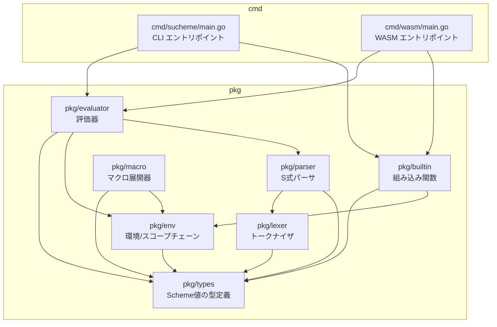
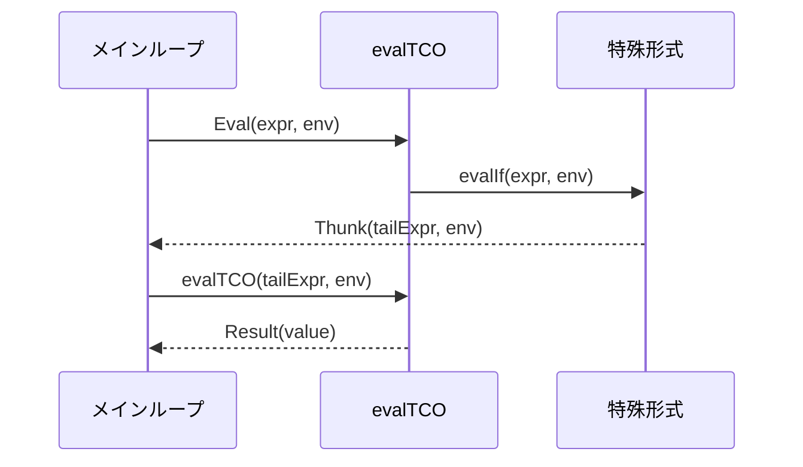
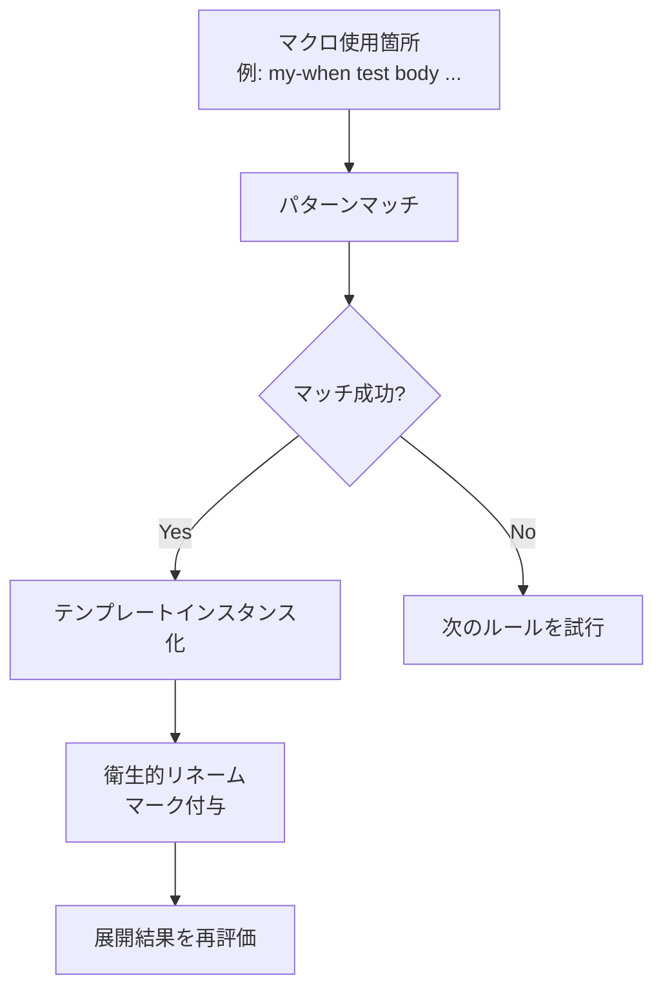
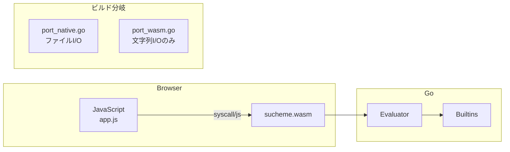
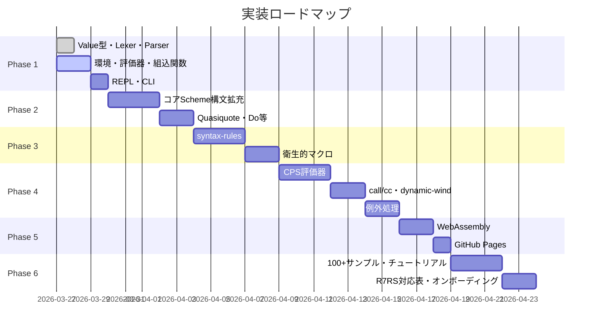

# Sucheme アーキテクチャ設計プラン

| 項目 | 値 |
|------|-----|
| 作成日 | 2026-03-28 |
| ステータス | 実装完了 |
| 関連PR | #2 (evaluator/env/builtin) |

## 概要

Sucheme は Go で実装する R7RS 準拠の Scheme インタプリタ。
このドキュメントは詳細な技術設計を記録する。

## 1. パッケージ構成



> **注意**: 循環依存を避けるため、`types` パッケージは `Env` インターフェースを定義し、
> `env` パッケージがそれを実装する。将来的に単一パッケージ (`pkg/scheme`) への統合も検討する。

## 2. コアデータ型

### Value 構造体（タグ付きユニオン）

```go
type Value struct {
    Type      ValueType
    IntVal    int64        // TypeInteger
    FloatVal  float64      // TypeFloat
    BoolVal   bool         // TypeBoolean
    CharVal   rune         // TypeCharacter
    StrVal    string       // TypeString
    SymbolVal string       // TypeSymbol
    PairVal   *Pair        // TypePair
    VecVal    []*Value     // TypeVector
    ProcVal   *Procedure   // TypeProcedure
    ByteVec   []byte       // TypeBytevector
    ValuesVal []*Value     // TypeValues
}
```

```mermaid
flowchart TD
    V[Value] --> |Type tag| T{ValueType}
    T --> |TypeInteger| I[IntVal: int64]
    T --> |TypeFloat| F[FloatVal: float64]
    T --> |TypeBoolean| B[BoolVal: bool]
    T --> |TypeCharacter| C[CharVal: rune]
    T --> |TypeString| S[StrVal: string]
    T --> |TypeSymbol| SY[SymbolVal: string]
    T --> |TypePair| P[PairVal: *Pair]
    T --> |TypeVector| VE[VecVal: []*Value]
    T --> |TypeProcedure| PR[ProcVal: *Procedure]
```

### 設計判断

| 判断 | 選択 | 理由 |
|------|------|------|
| Value表現 | タグ付き構造体 + `any` ref | unsafe不要、WASM互換 |
| 文字列 | Go string（不変） | R7RS mutable stringは将来 `[]rune` へ移行検討 |
| シンボル | 文字列比較 | 将来インターンに移行可能 |
| メモリ管理 | Go GC に委譲 | 循環参照も正しく回収 |

## 3. 評価器設計

### Phase 1: トランポリン方式 TCO（現在の実装）



```go
type thunk struct {
    expr *types.Value
    env  *env.Env
}

type evalResult struct {
    value *types.Value
    thunk *thunk  // non-nil → 継続評価が必要
}

func Eval(expr *Value, e *Env) (*Value, error) {
    result := evalTCO(expr, e)
    for result.thunk != nil {
        result = evalTCO(result.thunk.expr, result.thunk.env)
    }
    return result.value, nil
}
```

### Phase 2: CPS（継続渡しスタイル）への移行（将来）

```go
type Cont func(Value) Thunk

func Eval(expr Value, env *Env, k Cont) Thunk
```

CPS 方式では `call/cc` が自然に実現できる:

```go
func evalCallCC(args Value, env *Env, k Cont) Thunk {
    return Eval(Car(args), env, func(proc Value) Thunk {
        cont := MakeContinuation(func(val Value) Thunk {
            return k(val)  // 保存した継続を再開
        })
        return applyProcedure(proc, []Value{cont}, k)
    })
}
```

## 4. マクロシステム設計

### 衛生的マクロ（syntax-rules）



### パターンマッチ

```
(syntax-rules (リテラル...)
  (パターン1 テンプレート1)
  (パターン2 テンプレート2)
  ...)
```

- **リテラル**: 構文キーワードとして扱う識別子
- **パターン変数**: リテラル以外の識別子 → 対応する式に束縛
- **`_`**: ワイルドカード
- **`...`**: 省略記号（0回以上の繰り返し）

### 衛生性の実現

マーク方式（Kohlbecker方式）を採用:
- マクロ展開時に導入される識別子にフレッシュなマークを付与
- 同名でもマークが異なれば別の束縛として扱う

## 5. call/cc 実装方針

### 現在（Phase 1）: 未実装

### 将来（Phase 2）: CPS ベース

CPS 評価器では継続が明示的なので、`call/cc` は単に現在の継続をScheme値として具体化するだけ:

```go
// call/cc の実装
func evalCallCC(args Value, env *Env, k Cont) Thunk {
    return Eval(Car(args), env, func(proc Value) Thunk {
        cont := MakeContinuation(k)  // 現在の継続を値として捕獲
        return applyProcedure(proc, []Value{cont}, k)
    })
}
```

### dynamic-wind

継続の入退出時に before/after サンクを実行するための wind スタックを管理:

```go
type WindEntry struct {
    Before func()
    After  func()
}
```

## 6. 組み込み関数の構成

| カテゴリ | 関数数 | 例 |
|---------|--------|-----|
| 算術 | ~30 | `+`, `-`, `*`, `/`, `=`, `<`, `abs`, `sqrt` |
| リスト | ~20 | `cons`, `car`, `cdr`, `list`, `map`, `filter` |
| 文字列 | ~20 | `string-length`, `substring`, `string-append` |
| 文字 | ~15 | `char->integer`, `char-alphabetic?` |
| ベクタ | ~12 | `vector-ref`, `vector-set!`, `make-vector` |
| ブール | ~3 | `not`, `boolean?`, `boolean=?` |
| 等値 | ~3 | `eq?`, `eqv?`, `equal?` |
| I/O | ~15 | `display`, `write`, `read`, `open-input-string` |
| 制御 | ~5 | `apply`, `values`, `call-with-values` |

## 7. WebAssembly 対応



- `GOOS=js GOARCH=wasm` でビルド
- `//go:build js` タグでファイルI/Oを除外
- 文字列ポートは全プラットフォームで動作

## 8. 実装フェーズ



## 9. テスト戦略

- **1機能あたり10〜50のテストケース**
- **ユニットテスト**: 各関数の正常系・異常系
- **機能テスト**: 言語機能ごとの仕様準拠確認
- **統合テスト**: 複合的なSchemeプログラムの実行
- **境界テスト**: 空リスト、ゼロ除算、最大整数、型不一致
- **ベンチマーク**: 竹内関数、フィボナッチ、リスト操作

## 10. 重要ファイル一覧

| ファイル | 役割 |
|---------|------|
| `pkg/types/types.go` | Scheme値の型定義（全パッケージの基盤） |
| `pkg/evaluator/evaluator.go` | 評価器コア（TCO + 特殊形式） |
| `pkg/builtin/builtin.go` | 組み込み関数の実装 |
| `pkg/lexer/lexer.go` | トークナイザ |
| `pkg/parser/parser.go` | S式パーサ |
| `pkg/env/env.go` | 環境（スコープチェーン） |
| `cmd/sucheme/main.go` | CLI エントリポイント |
