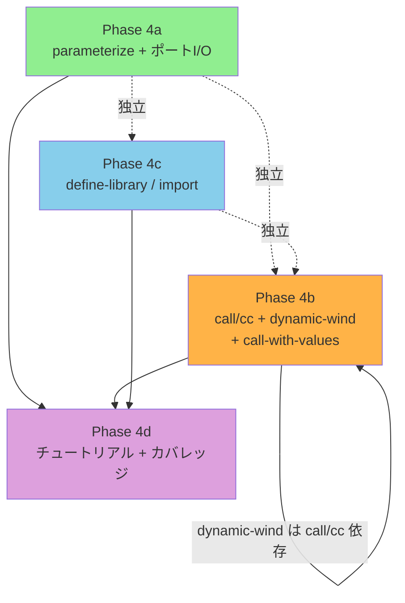
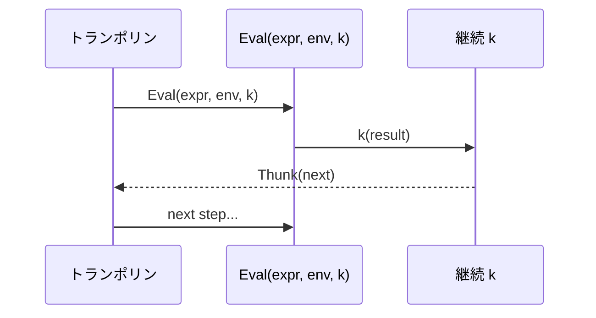

# Phase 4 実装戦略プラン

| 項目 | 値 |
|------|-----|
| 作成日 | 2026-03-28 |
| 完了日 | 2026-03-29 |
| ステータス | 実装完了 |
| 関連PR | #8 (parameterize/ports), #9 (call/cc/dynamic-wind), #12 (library system) |

## 概要

Phase 4 では R7RS の残りの高度な機能を実装する。
依存関係を分析し、並行可能な作業と順序依存の作業を明確にする。

## 依存関係グラフ

## フェーズ分割

### Phase 4a: parameterize + ポートI/O（独立、先行実装）

**ブランチ**: `feature/params-ports`

**作業内容**:
1. `make-parameter` — パラメータオブジェクト生成（コンバータ付き）
2. `parameterize` — 動的パラメータ束縛（特殊形式）
3. ポート抽象化 — `Port` 構造体（Reader/Writer ラッパー）
4. 入力ポート — `open-input-string`, `read-char`, `read-line`, `peek-char`, `char-ready?`, `eof-object?`, `eof-object`
5. 出力ポート — `open-output-string`, `get-output-string`, `write-char`, `write-string`
6. ポート述語 — `port?`, `input-port?`, `output-port?`, `textual-port?`
7. `current-input-port`, `current-output-port`, `current-error-port`（パラメータとして実装）
8. `close-port`, `close-input-port`, `close-output-port`

**設計判断**:
- `Procedure.ParamRef` フィールドを `any` 型で追加し、パラメータオブジェクトへのポインタを保持
- パラメータスタックはグローバル変数（シングルスレッド前提）
- ポートは `types.Value` に `PortVal` フィールドとして追加
- WASM環境ではファイルI/Oは使えないため、文字列ポートのみ

**テスト**: 20+ テストケース

**見積もり**: 中規模

---

### Phase 4b: call/cc + dynamic-wind + call-with-values（CPS評価器）

**ブランチ**: `feature/continuations`

**作業内容**:
1. CPS（継続渡しスタイル）評価器への移行
2. `call-with-current-continuation` (call/cc) — 継続の具体化
3. `dynamic-wind` — 継続の入退出時の before/after サンク実行
4. `call-with-values` — 多値の完全サポート
5. `values` — 多値返却の改善

**設計判断（最重要）**:

- **現在の評価器**: トランポリン方式 TCO（`thunk` + `evalResult`）
- **CPS移行**: `Eval(expr, env, k Cont)` で継続を明示的に渡す
- **call/cc**: 現在の継続 `k` を Scheme 値として具体化
- **dynamic-wind**: wind スタックで before/after を管理
- **互換性**: 既存の全テストが通ること

**リスク**:
- 評価器の大規模リファクタ。全特殊形式の書き換えが必要
- パフォーマンス低下の可能性（クロージャ生成増加）

**テスト**: 30+ テストケース（escape continuations, re-entrant continuations, Yin-Yang puzzle）

**見積もり**: 大規模

---

### Phase 4c: define-library / import / export

**ブランチ**: `feature/libraries`

**作業内容**:
1. `define-library` — ライブラリ定義
2. `import` — ライブラリインポート（prefix, only, except, rename）
3. `export` — シンボルエクスポート
4. 標準ライブラリの定義:
   - `(scheme base)` — 基本手続き
   - `(scheme case-lambda)` — case-lambda
   - `(scheme char)` — 文字操作
   - `(scheme eval)` — eval
   - `(scheme write)` — write/display
   - `(scheme read)` — read（未実装の場合はスタブ）

**設計判断**:
- ライブラリは `map[string]*Library` で管理（名前 → 環境+エクスポートリスト）
- `import` は起動時にグローバル環境に反映
- `include` / `include-ci` はファイル読み込みで実装

**テスト**: 15+ テストケース

**見積もり**: 中規模

---

### Phase 4d: チュートリアル + カバレッジ可視化

**ブランチ**: `feature/tutorials`

**作業内容**:
1. チュートリアルドキュメント（Mermaid図付き）
   - 入門編: 基本構文、データ型、関数定義
   - 中級編: クロージャ、高階関数、マクロ
   - 応用編: 例外処理、継続、ライブラリ
2. テストカバレッジ HTML レポートの CI 統合
3. カバレッジバッジの追加（README）
4. 全サンプルの動作確認テスト

**見積もり**: 小規模

---

## 並行実行計画

```mermaid
gantt
    title Phase 4 実装スケジュール
    dateFormat HH:mm
    axisFormat %H:%M

    section Phase 4a
        parameterize + ポートI/O :a1, 00:00, 2h
        PR + Copilot Review      :a2, after a1, 1h

    section Phase 4b
        CPS評価器リファクタ      :b1, after a2, 4h
        call/cc + dynamic-wind   :b2, after b1, 2h
        PR + Copilot Review      :b3, after b2, 1h

    section Phase 4c
        define-library / import  :c1, after a2, 2h
        PR + Copilot Review      :c2, after c1, 1h

    section Phase 4d
        チュートリアル + カバレッジ :d1, after b3, 2h
        PR + Copilot Review       :d2, after d1, 1h
```

**Phase 4a と 4c は並行実装可能**だが、Copilotレビューのマージ順序制約があるため、実際には:

1. **4a** を先に完了 → マージ
2. **4b** と **4c** を並行で開始（4b は大規模なので先にスタート）
3. **4b** 完了 → マージ、**4c** 完了 → マージ
4. **4d** で締め

## PR ルール（厳守）

各PRで以下を必ず守る:

1. フィーチャーブランチでコミット＆プッシュ
2. PR作成 → Copilotレビュー依頼
3. **レビュー完了を確認**（新規コメントが0になるまで）
4. 指摘があれば**意味論を保ったまま**修正 → 再プッシュ → 再レビュー
5. レビュー通過後にマージ
6. mainをpullして次へ

## 成功基準

- 全テストパス（`go test ./... -count=1`）
- 既存テスト354件が全てパスし続けること
- R7RS対応表が実装に正確に一致すること
- 全サンプルプログラムが動作すること
- パフォーマンスベンチマークに大きな劣化がないこと
