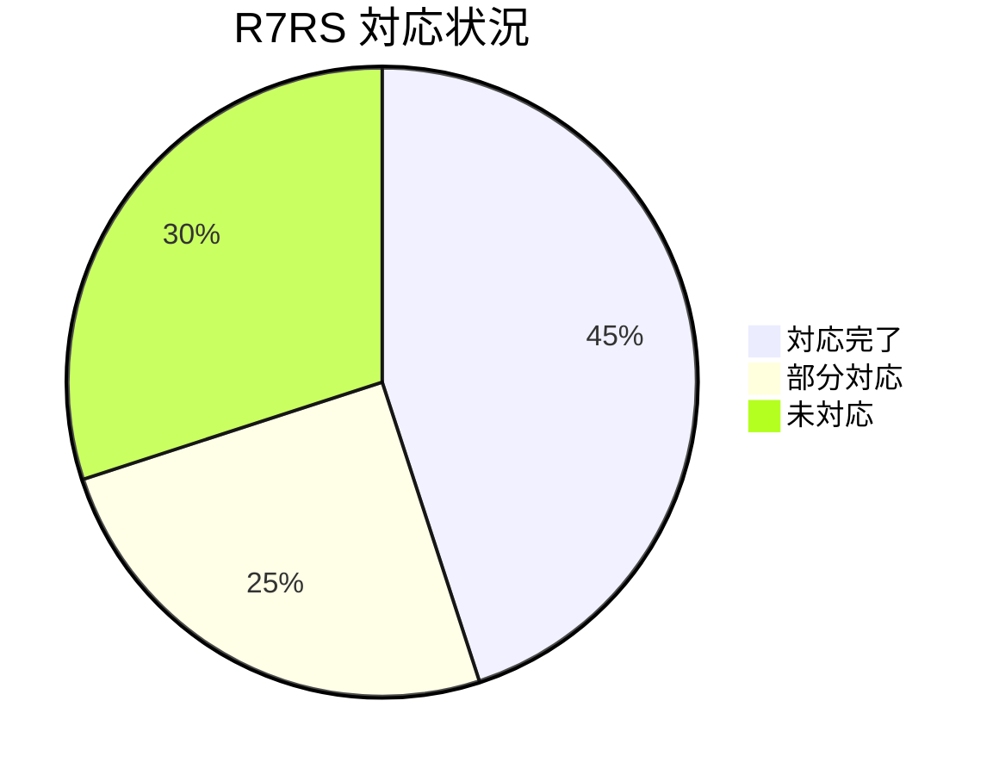

# Sucheme R7RS 対応状況

## 概要

Sucheme の R7RS (Revised⁷ Report on the Algorithmic Language Scheme) 準拠状況をまとめる。

## 判定基準

- **対応完了**: テストが境界例・特殊例を含めてすべてパス
- **部分対応**: 基本機能は動作するがエッジケースや完全な仕様準拠に不足あり
- **未対応**: 未実装

## 特殊形式

| 機能 | 状態 | 備考 |
|------|------|------|
| `quote` | 対応完了 | |
| `if` | 対応完了 | TCO対応 |
| `cond` | 対応完了 | else節、=> 構文対応 |
| `case` | 部分対応 | 基本形のみ |
| `and` | 対応完了 | 短絡評価 |
| `or` | 対応完了 | 短絡評価 |
| `when` | 対応完了 | |
| `unless` | 対応完了 | |
| `define` | 対応完了 | 変数定義、関数定義、ドット記法 |
| `set!` | 対応完了 | |
| `lambda` | 対応完了 | 固定引数、可変引数、ドット記法 |
| `let` | 対応完了 | 名前付きlet含む |
| `let*` | 対応完了 | |
| `letrec` | 対応完了 | 未初期化参照エラー |
| `letrec*` | 対応完了 | |
| `begin` | 対応完了 | TCO対応 |
| `do` | 対応完了 | |
| `quasiquote` | 対応完了 | ネスト深度追跡、ベクタ内splicing |
| `define-syntax` | 対応完了 | |
| `let-syntax` | 対応完了 | |
| `letrec-syntax` | 対応完了 | |
| `syntax-rules` | 対応完了 | 省略記号、リテラル、ワイルドカード、ドット対 |
| `guard` | 対応完了 | else、=> 構文対応 |
| `case-lambda` | 対応完了 | TCO維持 |
| `define-values` | 未対応 | |
| `define-record-type` | 未対応 | |
| `define-library` | 未対応 | |
| `import` | 未対応 | |
| `include` | 未対応 | |
| `include-ci` | 未対応 | |
| `cond-expand` | 未対応 | |
| `parameterize` | 未対応 | |
| `dynamic-wind` | 未対応 | |

## 例外処理

| 機能 | 状態 | 備考 |
|------|------|------|
| `raise` | 対応完了 | non-continuable |
| `raise-continuable` | 対応完了 | |
| `with-exception-handler` | 対応完了 | |
| `error` | 対応完了 | 文字列メッセージ + irritants |
| `error-object?` | 対応完了 | |
| `error-object-message` | 対応完了 | |
| `error-object-irritants` | 対応完了 | |

## 数値

| 機能 | 状態 | 備考 |
|------|------|------|
| 正確整数 (int64) | 対応完了 | |
| 不正確実数 (float64) | 対応完了 | |
| `+`, `-`, `*`, `/` | 対応完了 | 可変長引数 |
| `=`, `<`, `>`, `<=`, `>=` | 対応完了 | 型検証付き |
| `abs`, `min`, `max` | 部分対応 | |
| `modulo`, `remainder`, `quotient` | 対応完了 | |
| `floor`, `ceiling`, `truncate`, `round` | 部分対応 | |
| `sqrt`, `expt` | 部分対応 | |
| `number->string`, `string->number` | 対応完了 | |
| `exact->inexact`, `inexact->exact` | 部分対応 | |
| 有理数 | 未対応 | |
| 複素数 | 未対応 | |

## リスト

| 機能 | 状態 | 備考 |
|------|------|------|
| `cons`, `car`, `cdr` | 対応完了 | |
| `list`, `length`, `append`, `reverse` | 対応完了 | |
| `list-ref`, `list-tail` | 対応完了 | 負インデックスチェック |
| `list-copy` | 対応完了 | improper list対応 |
| `set-car!`, `set-cdr!` | 対応完了 | |
| `map`, `for-each` | 対応完了 | lambda/builtin両対応 |
| `filter` | 対応完了 | |
| `assoc`, `assv`, `assq` | 部分対応 | |
| `member`, `memv`, `memq` | 部分対応 | |
| `null?`, `pair?`, `list?` | 対応完了 | |
| `apply` | 対応完了 | lambda/builtin両対応 |
| `values` | 部分対応 | 単一値のみ完全 |

## 文字列

| 機能 | 状態 | 備考 |
|------|------|------|
| `string-length`, `string-ref` | 対応完了 | Unicode対応 |
| `string-append`, `substring` | 対応完了 | |
| `string->list`, `list->string` | 対応完了 | |
| `string-upcase`, `string-downcase` | 対応完了 | |
| `string=?`, `string<?`, `string>?` | 対応完了 | |
| `string-copy`, `make-string` | 対応完了 | |
| `string-set!` | 部分対応 | Go文字列は不変 |
| `symbol->string`, `string->symbol` | 対応完了 | |

## 文字

| 機能 | 状態 | 備考 |
|------|------|------|
| `char->integer`, `integer->char` | 対応完了 | |
| `char-alphabetic?`, `char-numeric?` 等 | 対応完了 | |
| `char-upcase`, `char-downcase` | 対応完了 | |
| `char=?`, `char<?`, `char>?` | 対応完了 | |

## ベクタ

| 機能 | 状態 | 備考 |
|------|------|------|
| `make-vector`, `vector` | 対応完了 | サイズ検証付き |
| `vector-ref`, `vector-set!` | 対応完了 | |
| `vector->list`, `list->vector` | 対応完了 | |
| `vector-fill!`, `vector-copy` | 対応完了 | |

## バイトベクタ

| 機能 | 状態 | 備考 |
|------|------|------|
| `make-bytevector` | 対応完了 | fill値 0..255 検証 |
| `bytevector-u8-ref`, `bytevector-u8-set!` | 対応完了 | |
| `bytevector-copy`, `bytevector-append` | 対応完了 | |

## ブール値・等値

| 機能 | 状態 | 備考 |
|------|------|------|
| `not`, `boolean?`, `boolean=?` | 対応完了 | |
| `eq?`, `eqv?`, `equal?` | 対応完了 | |

## I/O

| 機能 | 状態 | 備考 |
|------|------|------|
| `display`, `write`, `newline` | 対応完了 | CLI: stdout, WASM: キャプチャ |
| `read` | 未対応 | |
| `read-char`, `write-char`, `read-line` | 未対応 | |
| `open-input-file`, `open-output-file` | 未対応 | |
| `open-input-string`, `open-output-string` | 未対応 | |
| ポートシステム | 未対応 | |

## 継続

| 機能 | 状態 | 備考 |
|------|------|------|
| `call-with-current-continuation` | 未対応 | CPS評価器で将来対応予定 |
| `call-with-values` | 未対応 | |
| `dynamic-wind` | 未対応 | |

## ライブラリシステム

| 機能 | 状態 | 備考 |
|------|------|------|
| `define-library` | 未対応 | |
| `import` | 未対応 | |
| `export` | 未対応 | |
| `(scheme base)` | 未対応 | |
